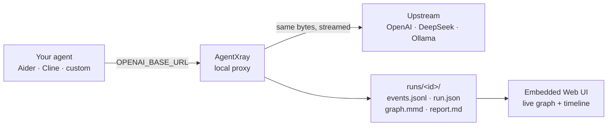

<p align="center"></p>

<h1 align="center">AgentXray</h1>

<p align="center"><b>X-ray your agent. No instrumentation, no SDK, no data leaving your machine.</b></p>

<p align="center">English · <a href="README.zh-CN.md">简体中文</a></p>

<p align="center">
  <a href="https://github.com/loadwww/agent-xray/actions/workflows/ci.yml"></a>
  <a href="https://github.com/loadwww/agent-xray/releases/latest"></a>
  <a href="LICENSE"></a>
  
</p>

AgentXray is a local reverse proxy that turns raw OpenAI-compatible traffic into an execution graph, a report, and a diff between runs.


- **Zero instrumentation** — point `OPENAI_BASE_URL` at the proxy. No SDK, no code change, no rebuild.
- **Local-first** — it's a plain HTTP proxy: data stays on your disk, headers and keys are redacted by default, and it binds to `127.0.0.1`.
- **Run diff** — run the same task twice and see which step changed, which tool call diverged, and where it started to go wrong.

## Quickstart

```bash
curl -fsSL https://raw.githubusercontent.com/loadwww/agent-xray/master/scripts/install.sh | sh
axr demo
```

`axr demo` opens a bundled, offline demo: two runs of the same coding task — one that works, one that edits the wrong file, fails the tests, and loops. No API key, no network.

Windows:

```powershell
irm https://raw.githubusercontent.com/loadwww/agent-xray/master/scripts/install.ps1 | iex
axr demo
```

## Why AgentXray

An agent loops or picks the wrong tool, and the only trace you have is a pile of HTTP requests. Instrumenting it means changing code and rebuilding — exactly when you don't want to touch anything.

AgentXray sits where the requests already go. It reconstructs LLM decisions, tool batches, timings, and token usage from the traffic itself, then renders them while the run is still going. It is not an evaluation platform: no datasets, no prompt management, no cloud.

## How it works



SSE responses are forwarded chunk by chunk as they arrive, so streaming clients keep their streaming behavior.

## What you get

- **Execution graph** — main model chain plus tool fan-out, rendered live (refreshes every 3s while a run is in progress).
- **Timeline** — total duration, per-step LLM slices, parallel tool bars, gaps between steps.
- **Failure flags** — confirmed failures (protocol `is_error` or an error in the tool result) in red, suspected ones (text heuristics) in amber; the banner tells you the earliest failing step.
- **Artifacts** — `events.jsonl`, `run.json`, `graph.mmd` (Mermaid), `meta.json`, `report.md` per run.
- **Diff** — `axr diff <runA> <runB>` aligns steps and tools and shows added/removed steps, changed arguments and results, token deltas.

## Works with

Anything that speaks OpenAI-compatible `chat/completions` and lets you change its base URL: Aider, Cline, Continue, Ollama, vLLM, LM Studio, LiteLLM, or your own OpenAI SDK / LangChain agent. That's the whole integration: one environment variable.

Not supported: Responses API, Anthropic `/v1/messages`, embeddings. Those are forwarded byte-for-byte but not reconstructed or counted (see [Limitations](#limitations)).

## Install

Linux x86_64 (prebuilt, sha256-verified, installs to `~/.local/bin`):

```bash
curl -fsSL https://raw.githubusercontent.com/loadwww/agent-xray/master/scripts/install.sh | sh
```

Windows x64 (prebuilt; installs to `%LOCALAPPDATA%\Programs\axr` and adds it to your user PATH):

```powershell
irm https://raw.githubusercontent.com/loadwww/agent-xray/master/scripts/install.ps1 | iex
```

Docker (ubuntu:24.04 + libcurl4, no toolchain in the image):

```bash
docker run --rm -p 8787:8787 ghcr.io/loadwww/agent-xray:latest
```

From source (Linux / macOS, C++17 + CMake, `libcurl4-openssl-dev` on Debian/Ubuntu):

```bash
cmake -S . -B build -DCMAKE_BUILD_TYPE=Release
cmake --build build -j
./build/axr selftest
```

## Usage

```bash
axr demo                                       # offline demo, opens the Web UI
axr demo --diff                                # print the diff between the two demo runs
axr serve --listen 8080                        # run as a proxy; open 127.0.0.1:8080/__xray
axr run -- your-agent-command                  # proxy + run the agent in one shot
axr show <runID|sessionID|dir>                 # terminal summary
axr report <runID|sessionID|dir>               # write report.md
axr diff <runA> <runB>                         # compare two runs
axr list --root <root> [--json]                # list runs
axr prune --days 7 --root <root> [--apply]     # clean old runs (dry-run by default)
```

Once the proxy is up, point your agent at it:

```bash
export OPENAI_BASE_URL="http://127.0.0.1:8080/v1"
```

Runs are written to `<root>/runs/<sessionID>/` (`%USERPROFILE%\.xray` by default).

## Configuration

Upstreams are matched by the longest prefix, which is then stripped:

```yaml
proxy:
  upstreams:
    - match: "/v1"        # /v1/chat/completions -> https://api.deepseek.com/v1/chat/completions
      url: "https://api.deepseek.com/v1"
      name: "deepseek"
      model_map:          # rewrite client-side model names before forwarding
        gpt-4o: deepseek-chat
    - match: "/ollama"    # -> http://127.0.0.1:11434/v1/...
      url: "http://127.0.0.1:11434"
      name: "ollama"

  inject_usage: true      # add stream_options.include_usage for streaming; auto-retries without it if upstream rejects
  capture: full           # full: store bodies; summary: only length + sha256 prefix
```

Logs are redacted by default: `authorization` / `x-api-key` / `api-key` headers and `sk-...` / `Bearer` values are replaced before they hit disk. The proxy never reuses your key for anything else.

## Comparison

If you need evals, prompt management, datasets, or a team cloud, use Langfuse (or LangSmith / Phoenix / Helicone). Those are the right tools for that job, and most of them require instrumenting the code you're trying to debug.

If you need to see what an **uninstrumented** agent actually did — and diff two runs of it — use AgentXray. They compose: AgentXray is the local view, the others are the warehouse.

## Limitations

1. Only OpenAI-compatible `chat/completions` (including SSE streaming) is reconstructed. Responses API, Anthropic `/v1/messages`, embeddings and model listings are forwarded but not parsed or counted.
2. Timings and tool failures are **inferred** from traffic, not declared by the agent. Confirmed failures come from protocol `is_error` or an error in the result JSON; everything else is a text heuristic and can be wrong. The pattern list is configurable (`proxy.tool_error_patterns`).
3. No evals, prompt management, datasets, multi-tenant hosting, or team collaboration. Those are explicitly out of scope.
4. Single machine, no auth. It binds to loopback; exposing it to the network requires `--allow-remote` and your own network boundary.
5. Tool results embedded in message text (e.g. smolagents `Observation:`) reconstruct the call and fan-out, but the tool table shows `-` for the result.
6. The Linux prebuilt is built on Ubuntu 24.04; older glibc distros may need a source build. macOS has no prebuilt yet.
7. The prebuilt Linux binary links the system `libcurl4`.

## Roadmap

- OTel export (`axr serve --otel-endpoint`) so a local trace can also land in Langfuse / Phoenix.
- Copy-paste recipes for more agents and frameworks.
- macOS Homebrew formula.

## Contributing

Issues, reproductions and docs fixes are all welcome. If you're unsure whether something is in scope, open a Discussion first — this is a single-maintainer project and scope is the main constraint. Build and test steps are in [CONTRIBUTING.md](CONTRIBUTING.md); security reports go through [SECURITY.md](SECURITY.md), not a public issue.

## License

[MIT](LICENSE) © 2026 loadwww
