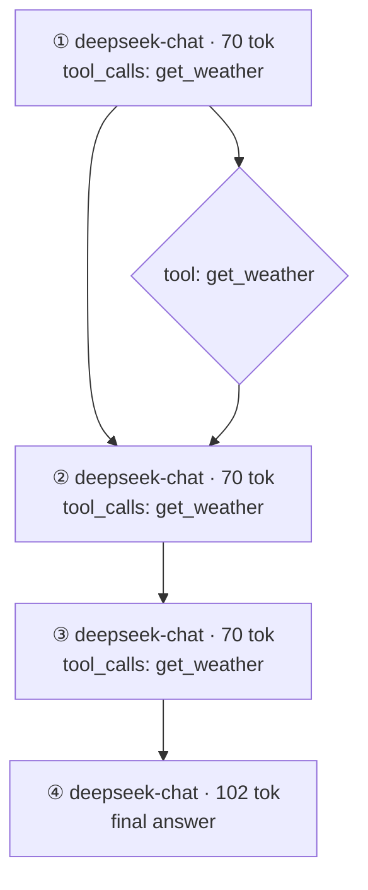

# AgentXray

零改造 Agent 执行流程逆向与可视化系统。CLI 名：`axr`。实现语言：C++17，采集模式：Mode A（反向代理）。

> 完整施工规格见 [docs/agent-xray-design.md](docs/agent-xray-design.md)。

## 快速开始（Windows）

**方式一：下载预编译（无需编译）**

```powershell
irm https://raw.githubusercontent.com/loadwww/agent-xray/master/scripts/install.ps1 | iex
```

下载最新的 `axr.exe` 到 `%LOCALAPPDATA%\Programs\axr` 并加入用户 PATH，然后：

```powershell
$env:OPENAI_API_KEY = "<你的 key>"
axr run -- python your_agent.py     # 自动起代理、注入 OPENAI_BASE_URL、跑完自动收尾
axr show <runID>                    # 看步骤 / token / 成本
```

**方式二：从源码构建**（需要 VS 2022 或 Build Tools，勾选「使用 C++ 的桌面开发」）

```powershell
powershell -ExecutionPolicy Bypass -File scripts\build.ps1
```

脚本会自动定位 MSVC、Windows SDK 与 VS 自带的 CMake/Ninja，产物为 `build\axr.exe`
（静态 CRT，单文件，只依赖系统 `WINHTTP/KERNEL32/WS2_32`）。

一键回归（构建 + 151 条自检）：

```powershell
powershell -ExecutionPolicy Bypass -File tests\run_tests.ps1
```

M2 端到端验收（离线 mock，无需任何 API key）：

```powershell
powershell -ExecutionPolicy Bypass -File tests\e2e_proxy.ps1
```

## 内置 Web UI（流程图直接在浏览器看）

`axr serve` 起来后，浏览器访问同一端口即可（页面内嵌在 exe 里，不需要联网、不依赖 CDN）：

```
http://127.0.0.1:8080/__xray
```

浏览器直接打开 `http://127.0.0.1:8080/` 也会自动返回页面（仅当 `Accept: text/html`，API 客户端的 `GET /` 仍照常转发）。

页面内容：

- 左侧 run 列表（每 3 秒自动刷新，能看到正在采集的 run）
- 右侧流程图：Step 节点纵向串联，工具节点横向扇出，模糊匹配边为橙色虚线，失败工具标红
- 步骤明细表 + 可展开的完整回复 / 工具参数与结果
- Mermaid 源码（可复制到 mermaid.live 查看官方渲染版）

数据来源分两种：已经 `Ctrl+C` 收尾的 run 读 `run.json`（成本已写回）；还在采集中的 run 直接从
`events.jsonl` 实时建链，因此跑 AutoGPT 之类长任务时可以边跑边看。接口只有两个：

```
GET /__xray/api/runs         # run 列表（JSON 数组）
GET /__xray/api/run?id=<id>  # 单个 run 的步骤 / 成本 / mermaid 源码
```

## 已实现命令

```powershell
# M1：离线回放与自检
build\axr.exe selftest                                  # 151 条断言：hash / model / SSE / 链 / fuzzy / 配置 / 路由 / 脱敏 / 录制 / 成本 / 报告 / diff / prune
build\axr.exe replay tests\fixtures\deepseek_tool_2 --format mermaid --out build\graph.mmd
build\axr.exe replay tests\fixtures\t2_single_tool --format json

# M2：真流量接入
build\axr.exe serve --config config.yaml                        # 前台代理，Ctrl+C 结束并落盘
build\axr.exe run -- python my_agent.py                         # 起代理 + 跑子进程 + 自动收尾
build\axr.exe run --config tests\proxy_test.yaml -- python tests\fake_agent.py

# M3：分析质量
build\axr.exe show tests\fixtures\t12_long_chain               # 终端摘要：请求数/重试/步数/成本/时间线/工具扇出
build\axr.exe report tests\fixtures\t7_fuzzy --out build\r.md  # 生成 Markdown 报告（默认写到 events.jsonl 同目录 report.md）

# M4：工程化
build\axr.exe list --root build\e2e-runs                        # 列出所有 run（读 meta.json；--json 供脚本消费）
build\axr.exe list --root build\e2e-runs --json
build\axr.exe show --bench tests\fixtures\t12_long_chain        # 顺带打印建链耗时（性能验收）
build\axr.exe export --root build\e2e-runs <runID> --format mermaid
build\axr.exe export --root build\e2e-runs <runID> --format json --out build\run.json
build\axr.exe diff tests\fixtures\t13_diff_base tests\fixtures\t13_diff_cur
build\axr.exe prune --days 7 --root build\e2e-runs              # 默认 dry-run，只列出将删除的目录
build\axr.exe prune --days 7 --root build\e2e-runs --apply      # 真正删除
```

## M2 工作方式

`axr run` 会在本机起一个反向代理（默认 `127.0.0.1:8080`），把
`OPENAI_BASE_URL` / `OPENAI_API_BASE` / `DEEPSEEK_BASE_URL`（→ `.../v1`）和
`OLLAMA_HOST`（→ `.../ollama`）注入子进程环境，因此**客户端代码零改造**。
每条上游请求/响应（含 SSE 分片）都写入会话目录：

```
<storage.root>/runs/<sessionId>/
  events.jsonl   # req / sse_chunk / sse_end / resp / err
  run.json       # 还原出的 Run 步骤
  graph.mmd      # Mermaid 流程图
  meta.json      # 摘要（步数、工具数、token、完整性、模型）
```

上游地址在 `config.yaml` 的 `proxy.upstreams` 配置。路由规则为**最长前缀匹配 + 剥离 match 前缀**：

```yaml
proxy:
  upstreams:
    - match: "/v1"        # /v1/chat/completions → https://api.deepseek.com/v1/chat/completions
      url: "https://api.deepseek.com/v1"
      name: "deepseek"
    - match: "/ollama"    # /ollama/chat/completions → http://127.0.0.1:11434/v1/chat/completions
      url: "http://127.0.0.1:11434/v1"
      name: "ollama"
```

### 模型名映射（`model_map`）

有些客户端只认自家枚举里的模型名（典型：AutoGPT classic 只接受 `gpt-4o`、`gpt-4-turbo`，
传 `deepseek-chat` 会在 `CHAT_MODELS` 查表时直接 KeyError）。给上游加 `model_map` 即可在转发前
把 `model` 字段换掉，客户端与上游都不用改：

```yaml
proxy:
  upstreams:
    - match: "/v1"
      url: "https://api.deepseek.com/v1"
      name: "deepseek"
      model_map:
        gpt-4o: deepseek-chat
        gpt-4o-mini: deepseek-chat
        gpt-4-turbo: deepseek-chat
```

命中后 `axr serve` 日志打印 `模型名改写: gpt-4o -> deepseek-chat`，落盘的 `req` 事件记录的是
改写后的请求体（即真实发给上游的内容），`meta.json` 里记 `"rewritten": true`。

落盘副本自动脱敏：`authorization` / `x-api-key` / `api-key` 头置为 `***`，
body 中 `sk-...` 形态密钥按正则替换；原始请求照常转发，不影响上游鉴权。

流式请求（`"stream": true`）走 **S2 真流式**（设计文档 §7.1.4）：上游在 worker 线程读取，
客户端由 `chunked` 内容提供者边收边写，不缓冲整体响应；队列满时对上游施压（背压），
客户端断开则中断上游读取。非流式请求照旧一次性缓冲。

### 补全流式 usage（`inject_usage`）

OpenAI 协议下流式响应默认不带 `usage`，这样每步 token / 成本都算不出来。可选开启改写：

```yaml
proxy:
  inject_usage: true    # 默认 false，只改写流式请求
```

开启后，仅对 `stream: true` 的请求补 `stream_options.include_usage = true`
（已带该字段时不动），被改写的请求数写入 `meta.json` 的 `"rewritten": true` 与
`axr run` 结束日志；请求体落盘记录的是改写后的版本。

## M3 分析质量

每次收尾除 `run.json` / `graph.mmd` / `meta.json` 外还会写 `report.md`，
包含概览、执行流程、时间线、工具调用表、成本表（含按模型 / 按工具归因）与备注。

成本按 `config.yaml` 的 `pricing` 段计价（USD / 1M tokens，cached 默认取 input 的 1/10）：

```yaml
pricing:
  # DeepSeek 官方按峰/谷两档计价，这里取峰值价保守估算（谷值为其 1/2）
  deepseek-flash:    { input: 0.30, output: 1.20, cached: 0.006 }
  deepseek-v4-pro:   { input: 1.32, output: 3.96, cached: 0.044 }
  deepseek-chat:     { input: 0.14, output: 0.28 }
  deepseek-reasoner: { input: 0.55, output: 2.20 }
  gpt-4o:            { input: 2.50, output: 10.00 }
  default:           { input: 1.00, output: 3.00 }   # 未列出的模型走这里
```

DeepSeek 的 `prompt_cache_hit_tokens` 会写入 `Usage.cachedTokens`，按 `cached` 单价单独计费
（上例 `$0.000402` 即两步 2176 个缓存命中 token 的实测结果）。

该段一旦出现即整段覆盖内建单价表（未列出的模型回落到 `default`）。
响应里没有 `usage` 的步骤成本记为 `n/a`，不会被当成 0 计入合计。

图与报告的几处标注：

- **模糊边**：请求前缀哈希失配、但消息相似度 ≥ `chain.fuzzy_threshold` 时连边，图上用虚线
  `-.->|推测|`，报告备注区会说明条数。
- **长链折叠**：步骤数超过 `chain.collapse_threshold`（默认 12）时，保留首 2 / 尾 2 步，
  中间连续带工具的步骤合并为一个 `「循环」` 节点（虚线框），避免图不可读。
- **步骤数 < 原始请求数**：重试请求（与前一条完全重复）不计入 Step，只累加 `原始请求 / 重试` 计数。
  因此 `axr show` 会打印 `原始请求 N（重试 R）· Step S`，S 可能小于 N。

`axr show <目录|runID>` 打印终端摘要（状态、token / 成本、时间线、工具扇出）；
`axr report <目录|runID> [--out 路径]` 生成 Markdown 报告，默认写到 `events.jsonl` 所在目录。

## M4 工程化

- `axr list`：扫描 `<root>/runs/*`，优先读 `meta.json`；没有 meta 的目录用目录名推导时间并标"无 meta"。
  `--json` 输出数组，字段固定（`dir/id/started_at/status/step_count/tool_count/total_tokens/cost_usd/...`）。
- `axr export`：`--format json` 输出与 `run.json` 同构的 Run（含每步 `cost_usd`）；
  `--format mermaid` 与 `graph.mmd` 同源（含折叠与模糊边规则）。
- `axr diff`：两个 run 按 **Step 序号对齐**，工具按出现顺序全局编号 `T0、T1…`，输出
  新增/删除的 Step、Step 内字段变化（模型 / token / kind / 工具）、以及工具级"参数变化 / 结果变化"，
  最后给出 token 与成本差值。示例：

  ```text
  步骤差异
    ~ 变化 S3：工具内容变化
    ~ 变化 S4：kind、token 915 → 820、tools
    + 新增 S5（deepseek-chat · 1065 tok）
  工具差异
    ~ 参数变化 T3 get_weather（S3）：{"city": "北京", "day": 4} → {"city": "上海", "day": 4}
  ```

- `axr prune`：按 run 目录 **mtime** 计算年龄，`--days N` 命中即列出；**默认 dry-run**，
  只有显式 `--apply` 才 `remove_all`。
- 性能：`axr show --bench` 打印建链耗时；`tests/fixtures/t12_long_chain`（50 步 / 51 请求）
  在 Release 构建下约 15ms（验收线 100ms，selftest 里有断言）。
- 打包：MSVC 使用**静态 CRT**（`CMAKE_MSVC_RUNTIME_LIBRARY=MultiThreaded`），
  `dumpbin /dependents build\axr.exe` 只剩 `WINHTTP.dll` / `KERNEL32.dll` / `WS2_32.dll` 三个系统 DLL，
  单个 `axr.exe` 即可分发。

## 示例输出（M2 抓到的真实 run）



| Step | Model | Prompt | Completion | Cost | 占比 |
|---|---|---|---|---|---|
| 1 | deepseek-chat | 50 | 20 | $0.000013 | 23% |
| 2 | deepseek-chat | 50 | 20 | $0.000013 | 23% |
| 3 | deepseek-chat | 50 | 20 | $0.000013 | 23% |
| 4 | deepseek-chat | 90 | 12 | $0.000016 | 29% |

Total: 4 steps · 312 tokens · $0.000054

## 真实 agent 对照测试（smolagents + DeepSeek）

用 GitHub 上的经典 agent 框架 [huggingface/smolagents](https://github.com/huggingface/smolagents)
（`ToolCallingAgent` + 真实 `@tool`）跑一次真实任务，验证"零改造、只看流量"的还原能力。

- 代码区：`D:\agents\smolagents-demo\agent.py`；环境区：`D:\env\agents\smolagents-venv`（venv 与代码分离）
- agent 代码**未为 axr 做任何改动**：只读 `OPENAI_BASE_URL`（由 `axr run` 注入）+ `OPENAI_API_KEY`
- 任务：用 `count_lines` 分别统计 README.md 与 config.yaml，再比较字符数

```powershell
$env:OPENAI_API_KEY = "<deepseek key>"
.\build\axr.exe run -- D:\env\agents\smolagents-venv\Scripts\python.exe D:\agents\smolagents-demo\agent.py
```

实测结果（`20261030-191815-79c7`）：`2 steps · 2 tools · 2851 tokens · $0.000402`，`status=complete`。

```mermaid
flowchart TD
    S0["① deepseek-flash · 1319 tok<br/>tool_calls: count_lines, count_lines"]
    S1["② deepseek-flash · 1532 tok<br/>tool_calls: final_answer"]
    S0 --> S1
    T0_0{"tool: count_lines<br/>{\"path\": \"D:\\agent-xray\\README.md\"}"}
    S0 --> T0_0
    T0_0 --> S1
    T0_1{"tool: count_lines<br/>{\"path\": \"D:\\agent-xray\\config.yaml\"}"}
    S0 --> T0_1
    T0_1 --> S1
```

| Step | Model | Prompt | Completion | Cost | 占比 |
|---|---|---|---|---|---|
| 1 | deepseek-flash | 1231（缓存 1024） | 88 | $0.000174 | 43% |
| 2 | deepseek-flash | 1413（缓存 1152） | 119 | $0.000228 | 56% |

Total: 2 steps · 2851 tokens · $0.000402

真实流量暴露并修复的三个兼容问题：

- **`~` 展开截断**：`expandHome` 误删 `.xray` 的末字符，run 目录变成 `C:\Users\欧阳晨\.xra/.xray/runs/...`；
  已改为完整剥离 `.xray` 后缀，selftest 增加"展开结果不含 `.xra/`"与"拼接一致"两条断言。
- **文本回填的工具结果**：smolagents 把工具结果以 `Observation:` 文本塞进下一条消息，协议层没有 `tool` 角色，
  因此"下一条请求新增的 tool 消息"为 0。`buildStep` 现在会把**本次响应声明的 tool_calls** 补成工具条目
  （`approx=true`、结果留空），保证 `tools` 计数与图上扇出不为 0。
- **终止工具**：smolagents 用 `final_answer` 这个"工具"交付答案，它没有后续请求。新增 `isTerminalTool`
  把它从工具表与 `kind` 判定中排除（`kind=final`），`validate` 也不再把它末步判为"采集不完整"。

已知局限（纯流量视角的固有缺口）：文本回填的工具**结果内容**落在下一条消息的正文字里，
目前不会回填到工具表（报告里结果摘要显示 `-`）；若接入 MCP 代理或上游使用标准 `tool` 消息，可完整还原。

## 与设计文档的偏离

| 项 | 设计文档 | 实现 | 原因 |
| --- | --- | --- | --- |
| HTTP 转发库 | libcurl（§7.1.3） | WinHTTP（`winhttp.lib`） | 本机无 libcurl 开发包/OpenSSL；WinHTTP 走系统 Schannel，零第三方依赖 |
| 路由拼接 | 示例间语义冲突 | 统一为"剥离 match 前缀 + url 作为上游基址" | 使 deepseek 与 ollama 两种上游同时可用 |
| SSE 客户端体验 | 流式透传（S1 先做、S2 真流式） | 已实现 S2：worker 线程读上游 + `chunked` 边收边写（背压 64 段、客户端断开即中断上游） | 设计文档 §7.1.4；S2 才是真实 agent 的默认形态 |
| "步骤数少于请求数"验收 | 未指定减量来源 | 以"重试请求不进 Step"实现：`tests/fixtures/t12_long_chain` 51 请求 / 50 步 | 常规 agent 每请求即一步，须有明确合法减量机制才可验证 |
| diff 对齐口径 | 未定义 | 按 Step 序号对齐（工具全局编号 T0、T1…） | 无标准答案，序号对齐可稳定复现"新增 S5 / T3 参数变化"验收 |
| 工具结果来源 | 仅从新增 `tool` 消息还原（§7.3.3） | 额外把响应 `tool_calls` 补成工具条目（结果留空） | smolagents 等框架以文本 `Observation:` 回填，协议层无 tool 消息，不补则工具数为 0 |
| 终止工具 | 未定义 | `final_answer` 等终止工具不计工具、不做完整性告警 | agent 用"工具调用"交付最终答案，本身无后续请求 |

## 已知边界（§7.3.7）

- **并行子 agent 的交错链**：归属靠"下一个请求里是否出现某条 tool_result"判断，两个子 agent 并发写同一条
  messages 序列时仍可能误判。本期策略是把可疑的分支切成独立 run，不展开 run 树。
- **无状态客户端（每轮全量重发）**：前缀哈希天然更准，是优势场景；反之只追加增量的客户端需要模糊匹配兜底，
  图中对应边会标注"推测"。
- **一次 run 内换模型（fallback）**：前缀仍成立，只是各 Step 的 `model` 不同，成本按各步模型分别归因。
- **工具结果来自文本回填**：如 smolagents 用 `Observation:` 文本回填时，工具结果内容无法回填（详见上一节）。
- **超大请求体（T10）**：`proxy.max_body_bytes` 超限时由 httplib 在读 body 阶段直接回 413，
  代理拿不到完整请求，因此**不产生 `req` / `err` 事件**；这是一处刻意的"宁可少记也不占内存"取舍。

## 状态

- [x] 阶段 0：环境搭建（MSVC 14.41 / WinSDK 10.0.22621 / CMake 3.29.5 / Ninja 1.11）
- [x] 阶段 1（M1）：离线闭环 — mock fixture → parse → chain → mermaid
- [x] 阶段 2（M2）：真流量接入（反向代理 + 录制 + `axr run`）
- [x] 阶段 3（M3）：分析质量（superstep / fuzzy / validate / cost / report）
- [x] 阶段 4（M4）：工程化（diff / prune / list / export / 性能 / 单文件打包）
- [x] 阶段 5：真实 agent 对照（smolagents + DeepSeek 真流量，2 步 / 2 工具 / complete）
