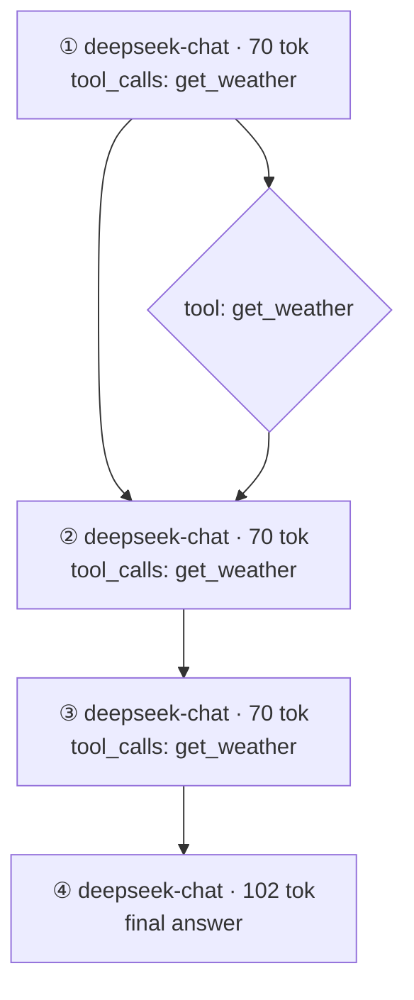

# AgentXray

零改造 Agent 执行流程逆向与可视化系统。CLI 名：`axr`。实现语言：C++17，采集模式：Mode A（反向代理）。

> 完整施工规格见 [docs/agent-xray-design.md](docs/agent-xray-design.md)。

## 构建（Windows / MSVC）

环境隔离在 `D:\env\axr`，代码区不存放任何工具链。

```powershell
. D:\env\axr\env.ps1          # 初始化 MSVC + WinSDK + CMake + Ninja
cmake -B build -G Ninja -DCMAKE_BUILD_TYPE=Release
cmake --build build
```

产物：`build\axr.exe`

一键回归（环境初始化 + 构建 + 自检）：

```powershell
powershell -ExecutionPolicy Bypass -File tests\run_tests.ps1
```

M2 端到端验收（离线 mock，无需任何 API key）：

```powershell
powershell -ExecutionPolicy Bypass -File tests\e2e_proxy.ps1
```

## 已实现命令

```powershell
# M1：离线回放与自检
build\axr.exe selftest                                  # 136 条断言：hash / model / SSE / 链 / fuzzy / 配置 / 路由 / 脱敏 / 录制 / 成本 / 报告 / diff / prune
build\axr.exe replay tests\fixtures\deepseek_tool_2 --format mermaid --out build\graph.mmd
build\axr.exe replay tests\fixtures\t2_single_tool --format json

# M2：真流量接入
build\axr.exe serve --config config.yaml                        # 前台代理，Ctrl+C 结束并落盘
build\axr.exe run -- python my_agent.py                         # 起代理 + 跑子进程 + 自动收尾
build\axr.exe run --stream -- python my_agent.py                # 同上（录制 SSE 逐 chunk）
build\axr.exe run --config tests\proxy_test.yaml -- python tests\fake_agent.py

# M3：分析质量
build\axr.exe show tests\fixtures\t12_long_chain               # 终端摘要：请求数/重试/步数/成本/时间线/工具扇出
build\axr.exe report tests\fixtures\t7_fuzzy --out build\r.md  # 生成 Markdown 报告（默认写到 events.jsonl 同目录 report.md）

# M4：工程化
build\axr.exe list --root build\e2e-runs                        # 列出所有 run（读 meta.json；--json 供脚本消费）
build\axr.exe list --root build\e2e-runs --json
build\axr.exe show --bench tests\fixtures\t12_long_chain        # 顺带打印建链耗时（性能验收）
build\axr.exe export --root build\e2e-runs <runID> --format mermaid
build\axr.exe export --root build\e2e-runs <runID> --format json --out build\run.json
build\axr.exe diff tests\fixtures\t13_diff_base tests\fixtures\t13_diff_cur
build\axr.exe prune --days 7 --root build\e2e-runs              # 默认 dry-run，只列出将删除的目录
build\axr.exe prune --days 7 --root build\e2e-runs --apply      # 真正删除
```

## M2 工作方式

`axr run` 会在本机起一个反向代理（默认 `127.0.0.1:8080`），把
`OPENAI_BASE_URL` / `OPENAI_API_BASE` / `DEEPSEEK_BASE_URL`（→ `.../v1`）和
`OLLAMA_HOST`（→ `.../ollama`）注入子进程环境，因此**客户端代码零改造**。
每条上游请求/响应（含 SSE 分片）都写入会话目录：

```
<storage.root>/runs/<sessionId>/
  events.jsonl   # req / sse_chunk / sse_end / resp / err
  run.json       # 还原出的 Run 步骤
  graph.mmd      # Mermaid 流程图
  meta.json      # 摘要（步数、工具数、token、完整性、模型）
```

上游地址在 `config.yaml` 的 `proxy.upstreams` 配置。路由规则为**最长前缀匹配 + 剥离 match 前缀**：

```yaml
proxy:
  upstreams:
    - match: "/v1"        # /v1/chat/completions → https://api.deepseek.com/v1/chat/completions
      url: "https://api.deepseek.com/v1"
      name: "deepseek"
    - match: "/ollama"    # /ollama/chat/completions → http://127.0.0.1:11434/v1/chat/completions
      url: "http://127.0.0.1:11434/v1"
      name: "ollama"
```

落盘副本自动脱敏：`authorization` / `x-api-key` / `api-key` 头置为 `***`，
body 中 `sk-...` 形态密钥按正则替换；原始请求照常转发，不影响上游鉴权。

## M3 分析质量

每次收尾除 `run.json` / `graph.mmd` / `meta.json` 外还会写 `report.md`，
包含概览、执行流程、时间线、工具调用表、成本表（含按模型 / 按工具归因）与备注。

成本按 `config.yaml` 的 `pricing` 段计价（USD / 1M tokens，cached 默认取 input 的 1/10）：

```yaml
pricing:
  deepseek-chat:     { input: 0.14, output: 0.28 }
  deepseek-reasoner: { input: 0.55, output: 2.20 }
  gpt-4o:            { input: 2.50, output: 10.00 }
  default:           { input: 1.00, output: 3.00 }   # 未列出的模型走这里
```

该段一旦出现即整段覆盖内建单价表（未列出的模型回落到 `default`）。
响应里没有 `usage` 的步骤成本记为 `n/a`，不会被当成 0 计入合计。

图与报告的几处标注：

- **模糊边**：请求前缀哈希失配、但消息相似度 ≥ `chain.fuzzy_threshold` 时连边，图上用虚线
  `-.->|推测|`，报告备注区会说明条数。
- **长链折叠**：步骤数超过 `chain.collapse_threshold`（默认 12）时，保留首 2 / 尾 2 步，
  中间连续带工具的步骤合并为一个 `「循环」` 节点（虚线框），避免图不可读。
- **步骤数 < 原始请求数**：重试请求（与前一条完全重复）不计入 Step，只累加 `原始请求 / 重试` 计数。
  因此 `axr show` 会打印 `原始请求 N（重试 R）· Step S`，S 可能小于 N。

`axr show <目录|runID>` 打印终端摘要（状态、token / 成本、时间线、工具扇出）；
`axr report <目录|runID> [--out 路径]` 生成 Markdown 报告，默认写到 `events.jsonl` 所在目录。

## M4 工程化

- `axr list`：扫描 `<root>/runs/*`，优先读 `meta.json`；没有 meta 的目录用目录名推导时间并标"无 meta"。
  `--json` 输出数组，字段固定（`dir/id/started_at/status/step_count/tool_count/total_tokens/cost_usd/...`）。
- `axr export`：`--format json` 输出与 `run.json` 同构的 Run（含每步 `cost_usd`）；
  `--format mermaid` 与 `graph.mmd` 同源（含折叠与模糊边规则）。
- `axr diff`：两个 run 按 **Step 序号对齐**，工具按出现顺序全局编号 `T0、T1…`，输出
  新增/删除的 Step、Step 内字段变化（模型 / token / kind / 工具）、以及工具级"参数变化 / 结果变化"，
  最后给出 token 与成本差值。示例：

  ```text
  步骤差异
    ~ 变化 S3：工具内容变化
    ~ 变化 S4：kind、token 915 → 820、tools
    + 新增 S5（deepseek-chat · 1065 tok）
  工具差异
    ~ 参数变化 T3 get_weather（S3）：{"city": "北京", "day": 4} → {"city": "上海", "day": 4}
  ```

- `axr prune`：按 run 目录 **mtime** 计算年龄，`--days N` 命中即列出；**默认 dry-run**，
  只有显式 `--apply` 才 `remove_all`。
- 性能：`axr show --bench` 打印建链耗时；`tests/fixtures/t12_long_chain`（50 步 / 51 请求）
  在 Release 构建下约 15ms（验收线 100ms，selftest 里有断言）。
- 打包：MSVC 使用**静态 CRT**（`CMAKE_MSVC_RUNTIME_LIBRARY=MultiThreaded`），
  `dumpbin /dependents build\axr.exe` 只剩 `WINHTTP.dll` / `KERNEL32.dll` / `WS2_32.dll` 三个系统 DLL，
  单个 `axr.exe` 即可分发。

## 示例输出（M2 抓到的真实 run）



| Step | Model | Prompt | Completion | Cost | 占比 |
|---|---|---|---|---|---|
| 1 | deepseek-chat | 50 | 20 | $0.000013 | 23% |
| 2 | deepseek-chat | 50 | 20 | $0.000013 | 23% |
| 3 | deepseek-chat | 50 | 20 | $0.000013 | 23% |
| 4 | deepseek-chat | 90 | 12 | $0.000016 | 29% |

Total: 4 steps · 312 tokens · $0.000054

## 与设计文档的偏离

| 项 | 设计文档 | 实现 | 原因 |
| --- | --- | --- | --- |
| HTTP 转发库 | libcurl（§7.1.3） | WinHTTP（`winhttp.lib`） | 本机无 libcurl 开发包/OpenSSL；WinHTTP 走系统 Schannel，零第三方依赖 |
| 路由拼接 | 示例间语义冲突 | 统一为"剥离 match 前缀 + url 作为上游基址" | 使 deepseek 与 ollama 两种上游同时可用 |
| SSE 客户端体验 | 流式透传 | M2 采用 S1 非流式缓冲：上游逐 chunk 录制，响应聚合成完整包返回客户端 | 设计文档 §7.1.4 建议 M2 先用 S1；录制保真度不受影响 |
| "步骤数少于请求数"验收 | 未指定减量来源 | 以"重试请求不进 Step"实现：`tests/fixtures/t12_long_chain` 51 请求 / 50 步 | 常规 agent 每请求即一步，须有明确合法减量机制才可验证 |
| diff 对齐口径 | 未定义 | 按 Step 序号对齐（工具全局编号 T0、T1…） | 无标准答案，序号对齐可稳定复现"新增 S5 / T3 参数变化"验收 |

## 状态

- [x] 阶段 0：环境搭建（MSVC 14.41 / WinSDK 10.0.22621 / CMake 3.29.5 / Ninja 1.11）
- [x] 阶段 1（M1）：离线闭环 — mock fixture → parse → chain → mermaid
- [x] 阶段 2（M2）：真流量接入（反向代理 + 录制 + `axr run`）
- [x] 阶段 3（M3）：分析质量（superstep / fuzzy / validate / cost / report）
- [x] 阶段 4（M4）：工程化（diff / prune / list / export / 性能 / 单文件打包）
