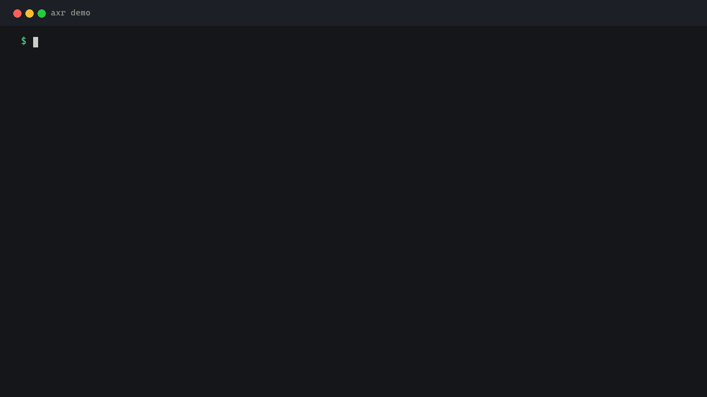
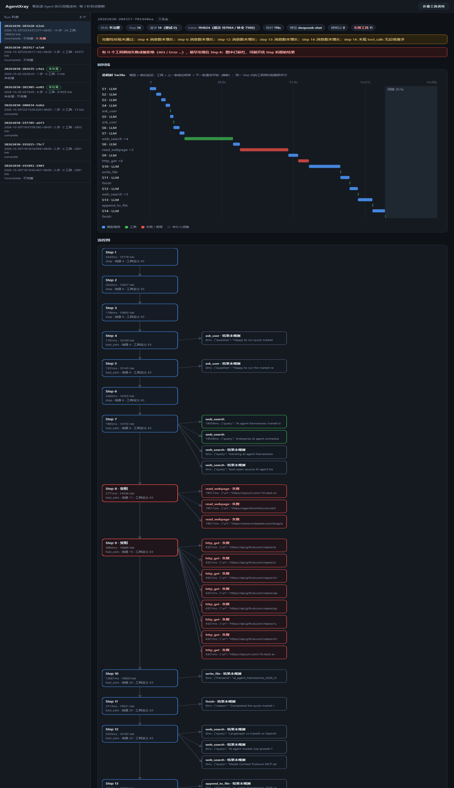

# AgentXray

**不改一行 Agent 代码，就能看清它每一步在想什么、调了哪个工具、在哪一步卡住。**

[English](README.md) · 中文

`axr` 是一个本地反向代理 + 可视化工具。你照常启动自己的 Agent，它把每一轮请求 / 响应（含流式分片）
录下来，还原成「主模型思考链路 + 工具调用扇出」，并在浏览器里**边跑边渲染**。

- 零改造：不接 SDK、不改代码、不重打包，只改一个 `OPENAI_BASE_URL`（不挑框架，但需走 OpenAI 兼容 chat completions）
- 看得懂：失败节点直接标红，顶部告诉你「最早在第几步受挫」
- 留得下：`events.jsonl` / `run.json` / `graph.mmd` / `report.md` 全部落盘，可回放、可比对
- 单文件：一个 `axr` 可执行文件，UI 内嵌，离线可用（Linux 版动态链接系统 `libcurl4`）

## 30 秒上手（离线 demo，不需要 API key）

```bash
axr demo
```

内置两次示例 run：run A 一次做对，run B 改错文件后绕圈并失败。命令会把示例释放到临时目录、
启动内嵌 Web UI 并自动打开浏览器；`axr demo --diff` 直接在终端看两次运行的步骤 / 工具差异。



## 支持矩阵

| 维度 | 支持 | 已知不支持 |
|---|---|---|
| 操作系统 | Windows x64、Linux x86_64 提供预编译包；macOS / 其他架构从源码构建 | 32 位 Windows |
| 协议 | OpenAI 兼容 chat completions（含流式 SSE），上游任意 HTTP/HTTPS | Responses API、Anthropic `/v1/messages`、embeddings、models 等端点：原样转发但不还原、不进统计 |
| 接入方式 | 只改 `OPENAI_BASE_URL` 一行 | 不改 base URL 的 MITM 证书模式（本期不做） |

## 实际长什么样



> 真实 AutoGPT 任务（14 步 / 24 次工具调用）。Step 8 的 `read_webpage ×3`、Step 9 的 `http_get ×8`
> 全部失败或被拒，自动标红，顶部提示「最早出现在 Step 8」；甘特图给出总耗时与工具的并行关系。
> 一键折叠后只看主模型链路：[折叠视图](docs/webui-collapsed.png)（`?collapse=1`）。

## 安装

Linux x86_64（预编译，无需编译；脚本会校验 SHA256，装到 `~/.local/bin`）：

```bash
curl -fsSL https://raw.githubusercontent.com/loadwww/agent-xray/master/scripts/install.sh | sh
```

Windows（预编译；装到 `%LOCALAPPDATA%\Programs\axr` 并加入用户 PATH，**新开**的终端生效）：

```powershell
irm https://raw.githubusercontent.com/loadwww/agent-xray/master/scripts/install.ps1 | iex
```

Docker（镜像基于 ubuntu:24.04 + libcurl4，不含编译工具链）：

```bash
# 直接跑离线 demo，浏览器打开 http://127.0.0.1:8787/__xray
docker run --rm -p 8787:8787 ghcr.io/loadwww/agent-xray:latest axr demo --no-open --port 8787 --bind 0.0.0.0 --allow-remote
# 代理模式，录制落到当前目录
docker run --rm -p 8080:8080 -v "$PWD:/data" ghcr.io/loadwww/agent-xray:latest serve --listen 8080 --bind 0.0.0.0 --allow-remote --root /data
```

macOS 与其他架构暂未提供预编译包，请从源码构建（见「构建（Linux/macOS）」）。

## 接到你的 Agent 上

```bash
export OPENAI_API_KEY="<你的 key>"                    # PowerShell: $env:OPENAI_API_KEY = "..."
export OPENAI_BASE_URL="http://127.0.0.1:8080/v1"     # 让 agent 走 axr 代理
axr serve --listen 8080                               # 起代理，浏览器打开 127.0.0.1:8080/__xray
axr show <runID>                                      # 终端看步骤 / token / 工具扇出
```

`axr serve` 是前台程序，不会自动弹浏览器，窗口关掉或 `Ctrl+C`（Linux 也支持 `kill -TERM`）就结束并落盘。
想让它不占用 agent 所在的终端，就在独立窗口里起（Windows）：

```powershell
Start-Process axr -ArgumentList 'serve','--listen','8080' -WorkingDirectory D:\agent-xray
```

长时间挂机时，当前会话空闲超过 `storage.idle_finalize_minutes`（默认 10 分钟）会自动收尾成
run 产物并开一个新会话，避免单个 `events.jsonl` 无限增长。启动时还会按 `storage.retention_days`
自动清理过期 run（<=0 关闭），手动执行用 `axr prune --auto`。

`config.yaml` 默认从**当前目录**读取；不在仓库目录时用 `--config D:\agent-xray/config.yaml`
（否则会静默使用内置默认上游，你的 `model_map` 等配置不生效）。

默认只监听本机回环、无鉴权；需要对外监听时显式加 `--allow-remote`。run 目录权限为 0700。

## 构建（Linux/macOS）

Python 侧无依赖，只需要 C++17 编译器与 CMake；Ubuntu/Debian 先 `sudo apt install cmake g++ libcurl4-openssl-dev`
（macOS 装 Xcode Command Line Tools 即可）。然后三条命令：

```bash
cmake -S . -B build -DCMAKE_BUILD_TYPE=Release
cmake --build build -j
./build/axr selftest          # selftest 不会随 cmake 自动跑，手动执行，全部通过即构建完整
```

产物是单个 `./build/axr` 与 `./build/mock_openai`；`bash tests/e2e_proxy.sh` 可离线跑一遍采集验收。

## 为什么实用

- **一眼定位失败**：协议层 `is_error` 或结果 JSON 带 `error` 字段 → 红色「失败」；结果文本命中
  `Error` / `403` / `Forbidden` / `Failed to` / `too much output` 等特征 → 琥珀色「疑似失败」
  （词表可用 `proxy.tool_error_patterns` 覆盖）。受挫的 Step 按同色标注，顶部横幅给出失败总数与
  最早出现的 Step，侧栏该 run 带「N 失败」徽标。
- **跑的时候就能看**：采集中的 run 每 3 秒刷新，直接读 `events.jsonl` 现建链（只续读新增事件，
  文件未变直接复用缓存），长任务不用等结束。
- **两种视角**：默认看完整图（工具分支全展开）；一键折叠只看主模型思考链路；顶部甘特图给出总耗时、
  每步 LLM 时间片、同名工具合并后的并行条与步骤间隙，并行 / 串行 / 卡点一目了然。
- **证据链完整**：每次 run 留下 `events.jsonl`、`run.json`、`graph.mmd`、`meta.json`、`report.md`，
  下次可以直接拿两份 run 做结构 diff，看是哪一步开始跑偏。
- **数据只说真话**：token 直接取上游响应的 `usage`（含 DeepSeek 缓存命中数），没有就显示 `-`，不估算；
  上游不返回账单，所以不展示金额，需要金额请用服务商后台或自己乘单价。
- **不侵入你的环境**：默认只监听本机回环，落盘副本自动脱敏（`authorization` / `x-api-key` / `api-key`
  头，`sk-...` / `Bearer` / `api_key` 值）；需要彻底不存正文时设 `proxy.capture: summary`，
  `events.jsonl` 只留长度与 sha256 前 16 位。确需对外监听时要显式加 `--allow-remote`。

## 能拿它做什么

| 场景 | 你怎么用 | 得到什么 |
|---|---|---|
| 工具报错排查 | `axr show <sessionID\|runID>`，或浏览器打开该 run | 失败的 Step 与工具、错误原文、失败发生在第几步 |
| 长任务复盘 | 收尾后看 `report.md` | 概览 / 执行流程 / 时间线 / 工具表 / Token 用量 |
| 两次运行对比 | `axr diff <runA> <runB>` | 新增或消失的 Step、参数 / 结果变化、token 差值 |
| 框架横向对比 | 同一任务分别接 AutoGPT、smolagents、手写脚本 | 步数、token、工具并行结构 |
| 教学 / 演示 | 浏览器打开实时页面 | 一张随时间推进的「Agent 内部发生了什么」 |

## 常用命令

```powershell
axr serve --listen 8080                        # 常驻代理（Ctrl+C 收尾）
axr show <sessionID|runID|目录>                 # 终端摘要：状态 / token / 模型 / 时间线 / 工具扇出
axr show <sessionID> --run <runID>              # 多 run session 里只看指定的非主 run
axr report <sessionID|runID|目录> [--out report.md]   # 生成 Markdown 报告
axr list --root <root> [--json] [--all]        # 列出所有 run（steps / tools / fail_tools / tokens）
axr export <sessionID|runID|目录> --format mermaid    # 导出流程图（json 则导出完整 Run）
axr diff <runA> <runB>                         # 按 Step 对齐比较两次运行
axr prune --days 7 --root <root> [--apply]     # 清理旧 run（默认 dry-run）
axr prune --auto --root <root>                 # 按 storage.retention_days 自动清理（serve 启动时同策略）
```

`show` / `report` / `export` 的第一个参数既可以是 session 目录（或 `events.jsonl` 路径），
也可以是 `sessionID`（如 `20261030-150000-4e87edbb`），还可以直接是某个 run 的 `runID`
（如 `20261030-150000-4e87edbb-9c3e-0000`，会自动定位到所属 session 并只看这一条）。
`--run` 用于在一个 session 有多个 run 时指定非主 run；`<root>` 默认是 `%USERPROFILE%\.xray`，
每个 run 一个目录：

```
<root>/runs/<sessionId>/
  events.jsonl   # req / sse_chunk / sse_end / resp / err
  run.json       # 还原出的步骤与工具
  graph.mmd      # Mermaid 流程图
  meta.json      # 摘要：步数、工具数、失败数、token、完整性、模型
  report.md      # Markdown 报告
```

## Web UI

页面内嵌在 exe 里，无 CDN、无需联网。起代理后直接访问：

```
http://127.0.0.1:8080/__xray                        # 页面
http://127.0.0.1:8080/__xray?id=<runID>             # 直接定位某次 run
http://127.0.0.1:8080/__xray?id=<runID>&collapse=1  # 默认折叠工具调用
```

也可以直接打开 `http://127.0.0.1:8080/`（仅当 `Accept: text/html`；API 客户端的 `GET /` 仍照常转发）。
给脚本消费的接口有两个：

```
GET /__xray/api/runs         # run 列表（steps / tools / failTools / tokens / live）
GET /__xray/api/run?id=<id>  # 单个 run：steps / token / failTools / 甘特图时间字段 / mermaid 源码
```

## 配置

上游按**最长前缀匹配 + 剥离 match 前缀**路由；写多条即可同时接入不同服务：

```yaml
proxy:
  upstreams:
    - match: "/v1"        # /v1/chat/completions → https://api.deepseek.com/v1/chat/completions
      url: "https://api.deepseek.com/v1"
      name: "deepseek"
      model_map:            # 客户端只认 gpt-4o 之类的名字时，转发前替换 model 字段
        gpt-4o: deepseek-chat
        gpt-4-turbo: deepseek-chat
    - match: "/ollama"    # /ollama/v1/chat/completions → http://127.0.0.1:11434/v1/chat/completions
      url: "http://127.0.0.1:11434"
      name: "ollama"

  inject_usage: true      # 默认开：流式请求补 stream_options.include_usage，否则拿不到 token；
                          # 上游 400 拒绝时自动去掉并重试，meta 记 usage_injected:false

  capture: full           # full 落盘请求/响应正文；summary 只存长度 + sha256 前 16 位

  tool_error_patterns:    # 工具失败文本词表（不配置则用内置词表；配置后整体覆盖）
    - "error:"
    - "permission denied"
```

`model_map` 命中后日志会打印 `模型名改写: gpt-4o -> deepseek-chat`，落盘记录的是真实发给上游的请求体。

### 可选：导出到 OTel 后端

默认一切留在本机。收尾后的 run 也可以按 OTLP/HTTP 导出：一个 run 一条 trace，每次 LLM 调用与工具执行都是带 `gen_ai.*` 属性的子 span。

```bash
axr serve --otel-endpoint http://localhost:4318/v1/traces
```

```yaml
otel:
  endpoint: "http://localhost:4318/v1/traces"   # 留空（默认）= 完全不导出、零网络
  service_name: "agentxray"
```

导出发生在 run 收尾时（空闲轮转或 Ctrl+C）。只导结构、计数与耗时；消息正文、工具参数与结果仍只留在本地 `run.json`。
可指向本地 OTel Collector，再喂给 Phoenix、Langfuse、Tempo 或任意 OTLP/HTTP 端点。

本地 Ollama 对外是 OpenAI 兼容的 `/v1`；经代理访问时把客户端 base URL 写成
`http://127.0.0.1:8080/ollama/v1`（由上面的 `/ollama` 路由转到 `http://127.0.0.1:11434/v1`）。
`axr run` 只注入 OpenAI 兼容的 `OPENAI_BASE_URL`/`OPENAI_API_BASE`/`DEEPSEEK_BASE_URL`，
不再注入 `OLLAMA_HOST`：该变量指向 ollama 原生 `/api/*`，代理不还原也不统计。

## 边界（如实说明）

- 只还原 OpenAI 兼容协议的 chat completions（路径以 `/chat/completions` 结尾，含流式 SSE，
  本地上游如 `http://127.0.0.1:11434/v1/chat/completions` 同样命中）。其它端点
  （Responses API、Anthropic `/v1/messages`、embeddings、models 列表等）**不还原、也不进统计**，
  但原始流量不丢：仍完整保存在 `events.jsonl`，并在 `meta.json` 计入 `unsupported_requests`
  （同时置 `parse_degraded: true`），Web UI 顶部会提示未还原的条数。
- 工具失败分两级：协议层 `is_error` 或结果 JSON 明确报错为**确认失败**（红），其余按文本启发式判为
  **疑似失败**（琥珀），个别措辞可能漏标或误判；详情页能看到原始结果自行确认，词表可配
  `proxy.tool_error_patterns`。
- 用 `Observation:` 文本回填工具结果的框架（如 smolagents），能还原工具调用与扇出，但**结果内容**落在
  下一条消息正文里，工具表的结果会显示 `-`。
- 并行子 agent 交错写同一 messages 链时，分支归属可能误判；建议把可疑分支拆成独立 run。
- 只监听本机回环，无鉴权；请勿暴露到公网。确要监听非回环地址必须显式加 `--allow-remote`，
  并自行保证网络边界。Linux / macOS 下 run 目录权限为 0700（仅属主可读写）。
- `proxy.capture: summary` 只保留请求/响应正文的长度与 sha256 前缀，因此对应 run 无法还原
  消息内容（会计入 `parse_failed`）。这类 run 仍会保留调用次数、时间线与 token 规模，
  但状态标记为 `incomplete`，`missing` 中写明「请求正文不可解析」，不会被当成成功的空任务。
- `proxy.max_body_bytes` 超限的请求由 HTTP 层直接回 413，代理拿不到完整请求体，因此不产生事件（宁可少记也不占内存）。
  上游响应正文超限时按截断保存（`truncated: true`）；截断的请求 / 响应不参与解析、计入
  `parse_failed`，链上仍保留这次调用但内容不可用。

## 待办

- **本地模型部署支持**（Ollama / llama.cpp / vLLM / LM Studio 等 OpenAI 兼容服务）：目标是
  `axr serve --local ollama` 自动把 `/v1` 指向 `http://127.0.0.1:11434/v1` 并跳过 API key 校验；
  本地服务不回 `usage` 时先补 `stream_options.include_usage`，仍拿不到就把 token 标为「未观测」，不估算。

## 版本与更新

当前版本 `v0.4.3`。Windows / Linux 预编译包随
[Releases](https://github.com/loadwww/agent-xray/releases) 发布；安装脚本总是拉取 latest，
`axr version` 可查看本地版本。

v0.4.3 变更：

- 可选 OTel 导出：`axr serve --otel-endpoint http://localhost:4318/v1/traces`（或配置 `otel.endpoint`），
  收尾后把一个 run 导成一条 trace，LLM 调用与工具执行为带 `gen_ai.*` 属性的子 span；只导结构 / 计数 / 耗时，
  默认不导出、零网络；
- Web 端 `/__xray/api/run` 长多字节正文不再返回 500，前端不再静默吞掉错误；
- 工具 `finish` 识别为终止工具，不再算作未完成的普通工具调用；
- 新增 `docs/recipes.md` 与 README 的 Works with 配方表、和 Langfuse / LangSmith / Phoenix / Helicone 的对比表；
- 预编译包自带 selftest fixtures，离线也能 `axr selftest` 全量自检。

v0.4.1 修复项：

- `run id` 追加 session 命名空间段，不同 session 即使首请求同秒、根哈希相同也不会撞 id；
- `axr show` / `report` / `export` 可直接传真实 `runID`（自动定位所属 session 并选中该 run），
  `show --help` / `list --help` 正常打印用法并返回 0；
- 请求正文不可解析（`capture: summary` 或截断）的 run 标记为 `incomplete`，`missing` 写明原因，
  不再显示成「成功的空壳任务」；
- full 模式下流式 `sse_chunk` 落盘前同样脱敏，转发给客户端的字节不受影响；
- Linux / macOS 下 `Ctrl+C` / `SIGTERM` 会收尾（flush + finalize），不再留下没有 meta 的采集中目录；
- `axr serve` 改为首个事件到来时才创建会话目录，空跑不留 0 步「无 meta」噪音；
- CI 增加 Windows / Linux 双平台 e2e（含流式脱敏、SIGINT 收尾、懒建会话用例）。

## 许可证

[MIT](LICENSE) © 2026 loadwww
