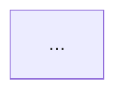

# AgentXray — 零改造 Agent 执行流程逆向与可视化系统

> 工作名：AgentXray（可改）。CLI 名：`axr`。
> **实现语言：C++17**。采集模式：**Mode A（反向代理）**。
> 本文档是给执行方（另一个对话）的施工规格书，不是介绍文章。`必须/禁止` 均为硬约束。

---

## 0. 一页纸摘要

**做什么**：一个本地服务，以反向代理的方式接收目标 agent 的 LLM 请求，转发给真实上游，同时把请求/响应完整录下来；随后自动还原"它跑了几步、每步调了什么工具、花了多少 token"，生成流程图 + 成本表 + 基线对比。

**核心卖点**：不读源码、不改代码、不挑框架，任何 agent 跑一遍就能出执行流程图。相当于"零改造版 LangGraph Studio"。

**技术核心**：用 **Merkle 式滚动前缀哈希**把散落的 N 条 HTTP 请求聚成一次 run，再做 **superstep（超级步）** 归并，最后渲染成 Mermaid 图。

**交付形态**：单个可执行程序 `axr.exe`，数据落在 `~/.xray/runs/`；不提供 Web 看板（见 §15）。

---

## 1. 目标与非目标

### 1.1 本期目标（必须做到）

| 编号 | 目标 | 验收方式 |
|---|---|---|
| G1 | 反向代理：接收明文 HTTP，转发到真实上游（HTTPS），零改造接入 | §11 的 T0 |
| G2 | 完整录制请求/响应，含 SSE 流式逐 chunk | T8 |
| G3 | 支持 OpenAI 兼容协议（覆盖 OpenAI / DeepSeek / Ollama / vLLM） | T1、T2 |
| G4 | 自动把 N 条请求聚成一次 run（前缀哈希算法） | T3 |
| G5 | 还原并行工具调用（一条 assistant 消息触发多个工具） | T5 |
| G6 | 完整性校验：缺请求时标记 `incomplete` 而非静默出错 | T11 |
| G7 | 生成 Mermaid 流程图 + 时间线 | 图能在 VS Code/GitHub 渲染 |
| G8 | 按步/按工具统计 token 与成本 | 与上游返回的 usage 完全一致 |
| G9 | 生成 markdown 报告（图 + 成本表） | `axr report` 产出的 md 可直接看 |
| G10 | 两个 run 的差异对比 | T7 |

### 1.2 明确不做（禁止扩大范围）

- ❌ **不做 TLS 劫持 / 自签 CA / 证书安装**（本期砍掉，见 §15 Future）
- ❌ 不做 SDK 侵入式接入
- ❌ 不做 Web 看板 / 前端
- ❌ 不做进程/文件系统层 hook
- ❌ 只支持 OpenAI 兼容协议；**Anthropic 原生格式进 Future**
- ❌ 不做云端、账号、多租户、并发压测
- ❌ 不做 gRPC / WebSocket 型 LLM 接口

> 任何"顺便加个功能"的想法一律记到 `BACKLOG.md`，不进本期。

---

## 2. 技术选型（C++17）

### 2.1 依赖清单

| 库 | 形态 | 用途 | 安装难度 |
|---|---|---|---|
| **nlohmann/json** | header-only（单头文件） | 全部 JSON 解析/生成 | 零配置，丢进 `third_party/` |
| **cpp-httplib** | header-only（单头文件） | HTTP 服务端（明文监听） | 零配置，丢进 `third_party/` |
| **libcurl** | 需要链接库 | 作为 HTTPS 客户端转发到上游 + 流式回调 | vcpkg 或官方预编译包 |
| CMake ≥ 3.16 | 构建 | — | 常规 |

**注意**：Mode A 下**不需要 OpenSSL 头文件**——你的服务端是明文 HTTP；出站 TLS 由 libcurl 内部完成。

### 2.2 构建骨架（CMakeLists.txt 关键片段）

```cmake
cmake_minimum_required(VERSION 3.16)
project(agentxray CXX)
set(CMAKE_CXX_STANDARD 17)
set(CMAKE_CXX_STANDARD_REQUIRED ON)

# header-only 依赖直接 include
include_directories(${CMAKE_SOURCE_DIR}/third_party)
# third_party/nlohmann/json.hpp
# third_party/cpp-httplib/httplib.h

find_package(CURL REQUIRED)      # vcpkg 或系统

file(GLOB_RECURSE SRC src/*.cpp)
add_executable(axr ${SRC})
target_link_libraries(axr PRIVATE CURL::libcurl)
```

Windows 下建议用 **vcpkg**：`vcpkg install curl:x64-windows`，然后 `-DCMAKE_TOOLCHAIN_FILE=<vcpkg>/scripts/buildsystems/vcpkg.cmake`。

### 2.3 为什么不用 Go（记录决策，供面试复盘）

| 维度 | C++ | Go |
|---|---|---|
| 你需要的 TLS 劫持 | 不做，故不需要 | 不做，故不需要 |
| 转发层代码量 | ~250 行（libcurl callback） | ~100 行（标准库） |
| 并发压力 | **本项目 agent 串行调用，几乎无并发** | 无差别 |
| 环境配置 | 需装 libcurl | 零配置 |
| 岗位对口 | **目标岗位为 C++ 后端，语言本身即加分** | 不加分 |

结论：C++ 的额外成本主要是"配一次 libcurl"，代码量差距不到 25%，而语言对口带来直接收益。**选择 C++。**

### 2.4 编码约束

- 全部代码 C++17；禁止使用 C++20 概念
- 内存管理一律 RAII，**禁止裸 `new/delete`**；容器优先 `std::vector/std::string`
- 错误用 `std::optional` + 错误码，或 `struct Result<T>{ T value; std::string err; }`（二选一，全项目统一）
- 日志：统一 `log(level, tag, msg)`，输出到 stderr，`--verbose` 才打印 debug
- 时间：`std::chrono::system_clock`，序列化用 RFC3339 字符串

---

## 3. 总体架构（Mode A 单向）

```
┌──────────────────────────────────────────────────────────────┐
│ 目标 agent（任意语言/框架，不改代码）                            │
│   OPENAI_BASE_URL=http://127.0.0.1:8080/v1                    │
└───────────────────────┬──────────────────────────────────────┘
                        │ 明文 HTTP（本地回环）
                        ▼
┌──────────────────────────────────────────────────────────────┐
│ proxy 层（cpp-httplib 监听 8080）                              │
│  ├ 读 body → 脱敏 → 落 events.jsonl                           │
│  ├ 用 libcurl 转发到真实上游（HTTPS，正常握手，无假证书）         │
│  └ 流式：边收边写给客户端，同时边录（Tee）                        │
└───────────────────────┬──────────────────────────────────────┘
                        ▼
┌──────────────────────────────────────────────────────────────┐
│ parse 层  OpenAI 兼容 → 统一 Message / LLMCall / LLMResponse   │
└───────────────────────┬──────────────────────────────────────┘
                        ▼
┌──────────────────────────────────────────────────────────────┐
│ chain 层 ★核心★                                                │
│  ├ Merkle 滚动前缀哈希 → 建父子关系                             │
│  ├ run 切分（根 + 时间窗）                                       │
│  ├ superstep 归并：LLMCall + 其触发的工具批次                     │
│  └ Validate：完整性校验 → incomplete 标记                       │
└───────────────────────┬──────────────────────────────────────┘
                        ▼
        ┌───────────────┴───────────────┐
        ▼                               ▼
┌────────────────┐            ┌────────────────┐
│  graph 层       │            │  cost 层        │
│  Mermaid + 时间线│            │  token/成本归因  │
└───────┬────────┘            └───────┬────────┘
        └───────────────┬─────────────┘
                        ▼
┌──────────────────────────────────────────────────────────────┐
│  ui 层（L1）CLI 输出 + report.md（内嵌 Mermaid + 成本表）        │
└──────────────────────────────────────────────────────────────┘
```

**一句话数据流**：流量 → 事件 → 统一对象 → 运行树 → 图/表 → 人看。

### 3.1 为什么不需要证书

代理不是"解密别人的 TLS"。客户端发来的是**明文 HTTP**（因为 base_url 指向 `http://127.0.0.1:8080`），代理再以**普通客户端身份**用 libcurl 访问 `https://api.deepseek.com`，用的是公开 CA 签发的合法证书。全程没有一方在伪造证书，所以**零信任配置、零安装步骤**。

### 3.2 与 Mode B（MITM）的边界

见 §15。本期**完全不实现**，但 `Source` 抽象要留好，使得未来加 MITM 只需新增一个实现类，上层零改动。

---

## 4. 目录结构

```
agentxray/
├── CMakeLists.txt
├── config.yaml
├── README.md
├── BACKLOG.md
├── third_party/
│   ├── nlohmann/json.hpp
│   └── cpp-httplib/httplib.h
├── src/
│   ├── main.cpp                  # 子命令分发
│   ├── common/
│   │   ├── log.h / log.cpp
│   │   ├── result.h              # Result<T> 与错误码
│   │   ├── time_util.h / .cpp    # RFC3339、时间戳
│   │   └── hash.h / .cpp         # sha256（可自写，见 §7.3）
│   ├── config/
│   │   └── config.h / config.cpp # yaml 解析（极简手写，不引 yaml-cpp）
│   ├── proxy/
│   │   ├── source.h              # Source 抽象（★预留 MITM）
│   │   ├── reverseproxy.h/.cpp   # Mode A 实现（cpp-httplib + libcurl）
│   │   ├── recorder.h/.cpp       # events.jsonl 落盘（异步队列）
│   │   ├── redact.h/.cpp         # 脱敏
│   │   └── inject.h/.cpp         # axr run 的环境变量注入 + 子进程
│   ├── parse/
│   │   ├── model.h/.cpp          # ★§5 数据结构 + json 互转
│   │   ├── openai.h/.cpp         # OpenAI 兼容请求/响应解析
│   │   ├── sse.h/.cpp            # SSE 状态机（流式拼接）
│   │   └── registry.h/.cpp       # 上游端点 → 配置映射
│   ├── chain/
│   │   ├── fingerprint.h/.cpp    # 规范化 + sha256
│   │   ├── prefix.h/.cpp         # Merkle 滚动前缀哈希
│   │   ├── link.h/.cpp           # 父子关系
│   │   ├── run.h/.cpp            # run 切分、根识别
│   │   ├── superstep.h/.cpp      # 步骤归并、工具配对
│   │   ├── fuzzy.h/.cpp          # 模糊匹配兜底
│   │   └── validate.h/.cpp       # 完整性校验
│   ├── graph/
│   │   ├── mermaid.h/.cpp
│   │   └── timeline.h/.cpp
│   ├── cost/
│   │   ├── price.h/.cpp
│   │   └── report.h/.cpp
│   ├── store/
│   │   └── store.h/.cpp          # runs/<id>/ 读写、meta 索引
│   └── cli/
│       ├── cmd_serve.cpp
│       ├── cmd_run.cpp
│       ├── cmd_list.cpp
│       ├── cmd_show.cpp
│       ├── cmd_report.cpp
│       ├── cmd_diff.cpp
│       ├── cmd_replay.cpp
│       └── cmd_prune.cpp
└── tests/
    ├── mock_openai.cpp           # ★可控实验台★
    ├── fixtures/                 # 录好的 events.jsonl
    └── run_tests.sh / .ps1
```

**依赖必须单向**：`proxy → parse → chain → graph/cost → ui`。禁止反向 include。

---

## 5. 核心数据结构（C++，必须先定稿）

> 执行方**第一个要写的文件**是 `src/parse/model.h`。所有模块围绕它展开，改名会引发全项目返工。

### 5.1 定义

```cpp
#pragma once
#include <string>
#include <vector>
#include <map>
#include <chrono>
#include <nlohmann/json.hpp>

namespace axr {

enum class Role { System, User, Assistant, Tool };

inline std::string toStr(Role r);
inline Role fromStr(const std::string& s);

// 多模态只存元信息，绝不把 base64 塞进结构体
struct Content {
    std::string type;      // "text" | "image"
    std::string text;      // type=="text" 时有效
    std::string mime;      // type=="image"
    int         bytes = 0;
    std::string digest;    // 图片内容的 sha256 前16位
};

struct ToolCall {
    std::string id;        // OpenAI: tool_call.id
    std::string name;
    std::string arguments; // 原始 JSON 字符串（流式拼接后的完整值）
};

struct ToolDef {
    std::string name;
    std::string description;
    std::string schemaJson; // parameters 的原始 JSON
};

struct Message {
    Role                role;
    std::vector<Content> content;
    std::vector<ToolCall> toolCalls;   // 仅 assistant
    std::string          toolCallId;   // 仅 tool
    bool                 isError = false;
};

struct Usage {
    int promptTokens = 0;
    int completionTokens = 0;
    int cachedTokens = 0;
};

struct LLMCall {
    std::string id;         // 内部生成：run 内唯一
    std::string provider;   // "openai"（含 deepseek/ollama/vllm）
    std::string model;
    std::string endpoint;   // 上游真实 URL
    std::vector<Message> messages;
    std::vector<ToolDef> tools;
    nlohmann::json params;  // temperature / max_tokens / tool_choice 等原样保存
    std::string startedAt;  // RFC3339
    std::string endedAt;
};

struct LLMResponse {
    std::string callId;
    std::string text;
    std::vector<ToolCall> toolCalls;
    Usage usage;
    std::string finishReason;
    bool streamed = false;
    std::string err;
    int latencyMs = 0;
};

struct ToolExec {
    std::string callId;
    std::string name;
    std::string arguments;
    std::string result;
    bool isError = false;
    int  durationMs = 0;
    bool approx = true;     // 从流量推断时恒为 true；MCP 代理可给精确值
};

struct Step {
    int index = 0;
    LLMCall call;
    LLMResponse response;
    std::vector<ToolExec> tools;   // 本轮并行触发的工具
    int tokens = 0;
    double costUsd = 0;
    std::string kind;              // "llm" | "final"
};

struct Run {
    std::string id;        // 时间 + 根哈希前8位
    std::string rootHash;
    std::string startedAt;
    std::string endedAt;
    std::vector<Step> steps;
    Usage total;
    double costUsd = 0;
    bool incomplete = false;        // ★完整性校验结果
    std::vector<std::string> missing; // 缺失步骤的描述
    std::vector<Run> children;      // 并行子链（本期预留，不做树展开）
    std::vector<std::string> tags;
};

} // namespace axr
```

### 5.2 JSON 互转约定

- 每个结构体提供 `to_json` / `from_json`（nlohmann 的 ADL 方式），写在 `model.cpp`
- `Role` 序列化为小写字符串
- 时间统一 RFC3339 字符串，**不存毫秒时间戳**（人类可读优先，diff 也更好看）
- 字段缺失时用默认值填充，**不要抛异常**（上游响应可能不完整）

### 5.3 硬约束

- `Content` 里**永远不出现 base64**，图片只留 digest
- `arguments` 保持**原始字符串**，不预先 parse（不同 provider 的格式差异留到需要时再处理）
- 禁止在结构体里放裸指针或 `char*`

---

## 6. 存储格式

### 6.1 目录布局

```
~/.xray/
└── runs/
    └── 20261030-143012-a1b2c3d4/
        ├── meta.json       # 轻量元信息，列表页只读它
        ├── events.jsonl    # 原始事件流，append-only
        ├── run.json        # chain 层产物（完整 Run）
        ├── graph.mmd       # Mermaid 源码
        └── report.md       # 生成报告
```

**本期不做压缩**（zstd 进 Future）。原因：C++ 引入压缩库不划算，且录制量级远小于预期（一次 run 通常几 MB）。

### 6.2 meta.json（必须小，< 2KB）

```json
{
  "id": "20261030-143012-a1b2c3d4",
  "started_at": "2026-10-30T14:30:12+08:00",
  "duration_ms": 48213,
  "step_count": 7,
  "tool_count": 5,
  "total_tokens": 24310,
  "cost_usd": 0.0341,
  "models": ["deepseek-chat"],
  "status": "complete",
  "incomplete": false
}
```

### 6.3 events.jsonl（append-only，不可修改）

每行一个事件：

```json
{"seq":1,"ts":"2026-10-30T14:30:12.100+08:00","kind":"req","hop":"h-1","upstream":"https://api.deepseek.com/v1/chat/completions","req_body":"{...}","req_headers":{"content-type":"application/json","authorization":"***"}}
{"seq":2,"ts":"2026-10-30T14:30:13.900+08:00","kind":"sse_chunk","hop":"h-1","data":"data: {\"choices\":[{\"delta\":{\"content\":\"你\"}}]}\n\n"}
{"seq":3,"ts":"2026-10-30T14:30:14.200+08:00","kind":"sse_end","hop":"h-1"}
{"seq":4,"ts":"...","kind":"resp","hop":"h-1","status":200,"latency_ms":2100}
```

`kind` 取值：`req` | `sse_chunk` | `sse_end` | `resp` | `err`。

**注意**：流式必须逐 chunk 存，否则无法复原"逐字生成"的时间分布，也无法在 chunk 里丢 usage 时兜底。

### 6.4 大小与保留

| 项 | 策略 |
|---|---|
| 单条 body | 超过 `max_body_bytes`（默认 8MB）截断并记 `truncated:true` |
| 图片 base64 | 抽出、算 digest、正文替换为占位符 |
| 单 run 总量 | 超过 `max_run_bytes`（默认 256MB）告警并停止录制 |
| 保留 | 默认 30 天，`axr prune --days 7` 清理 |

---

## 7. 分层规格

### 7.1 proxy 层（Mode A 反向代理）

**职责**：接收明文 HTTP，转发到真实上游，同时完整录制。

**接口（为未来 MITM 预留，必须这样抽象）**

```cpp
namespace axr {

class Source {
public:
    virtual ~Source() = default;
    virtual bool start(std::function<void(const Event&)> onEvent) = 0;
    virtual void stop() = 0;
};

class ReverseProxySource : public Source { /* 本期唯一实现 */ };
// Future: class MitmSource      : public Source { ... };  // §15
// Future: class McpProxySource  : public Source { ... };  // §15

} // namespace axr
```

上层只依赖 `Source`，**禁止在 chain/parse 里出现 `ReverseProxySource` 字样**。

---

#### 7.1.1 上游解析（配置驱动）

```yaml
proxy:
  listen: 8080
  upstreams:
    - match: "/v1"                       # 收到 /v1/chat/completions
      url:   "https://api.deepseek.com"  # 转发到 https://api.deepseek.com/v1/chat/completions
      name:  "deepseek"
    - match: "/ollama"
      url:   "http://127.0.0.1:11434"
      name:  "ollama"
```

规则：取最长匹配前缀，拼成上游 URL。**收到未匹配的路径直接返回 404 并记事件**（不要静默转发，否则会污染数据）。

#### 7.1.2 请求处理流程

```
1. 读 req body（限 max_body_bytes）
2. 生成 hopId（自增）
3. 脱敏 → 落 "req" 事件
4. 解析 body 判断是否 stream:true
5. libcurl 转发：
   - CURLOPT_URL = 拼好的上游 URL
   - 透传必要头：authorization / content-type / accept
   - 丢弃：host / content-length（让 curl 自己算）/ 任何 *proxy* 头
6. 分流：

   【非流式】
     - 收完整个 body → 落 "resp" 事件 → 原样返回给客户端
     - 解析 usage / tool_calls

   【流式】
     - CURLOPT_WRITEFUNCTION 每来一段：
         (a) 立刻写给客户端 sink（保证不被攒批）
         (b) push 进 recorder 队列（异步落盘）
     - 结束时落 "sse_end" + "resp" 事件
7. 解析阶段用累积的 chunk 重建完整 assistant 消息（见 §7.2 SSE）
```

#### 7.1.3 libcurl 关键设置（照抄）

```cpp
CURL* h = curl_easy_init();
curl_easy_setopt(h, CURLOPT_URL, upstreamUrl.c_str());
curl_easy_setopt(h, CURLOPT_POST, 1L);
curl_easy_setopt(h, CURLOPT_POSTFIELDS, body.data());
curl_easy_setopt(h, CURLOPT_POSTFIELDSIZE, (long)body.size());
curl_easy_setopt(h, CURLOPT_WRITEFUNCTION, onWrite);   // ★流式关键
curl_easy_setopt(h, CURLOPT_WRITEDATA, &ctx);
curl_easy_setopt(h, CURLOPT_HTTPHEADER, headers);
curl_easy_setopt(h, CURLOPT_TIMEOUT, 300L);
curl_easy_setopt(h, CURLOPT_NOSIGNAL, 1L);             // 多线程必需
curl_easy_setopt(h, CURLOPT_CONNECTTIMEOUT, 10L);
// 不要设 CURLOPT_ACCEPT_ENCODING，避免上游回 gzip 增加解析负担
```

`onWrite` 必须**尽快返回、不做重活**：只做 (a) 写 sink (b) 入队，落盘交给另一个线程。

#### 7.1.4 流式转发到客户端的两种实现（按阶段选）

| 方案 | 做法 | 难度 | 何时用 |
|---|---|---|---|
| **S1 非流式缓冲** | 全部收完再一次性返回 | 低 | **M1/M2 阶段先用这个**，先把链路跑通 |
| S2 真流式 | cpp-httplib 的 `set_chunked_content_provider` + 线程安全队列桥接 curl 回调 | **中高** | M3 阶段替换 |

> **强烈建议先用 S1。** S1 唯一的损失是"agent 看不到逐字输出"，但录制数据完全一样（因为 chunk 都已经落盘）。等 S2 做完再提升体验。这条能把 C++ 的最大难点推迟到算法验证完成之后。

S2 的关键是"两个线程之间的生产者-消费者"：

```cpp
// curl 线程（生产者）          // httplib 处理线程（消费者）
onWrite:                        provider(offset, sink):
  queue.push(chunk);              auto c = queue.pop_blocking(50ms);
  cv.notify_one();                 sink.write(c);
```

- 队列用 `std::mutex + std::condition_variable`，**不要自己写无锁队列**（本期不需要）
- 必须有"上游已结束"与"队列已空"的双条件，否则会死等
- `sink.write()` 返回 false 表示客户端断开 → 立刻 `curl_easy_cleanup` 中断上游

#### 7.1.5 录制器（异步落盘）

```cpp
class Recorder {
public:
    void push(Event e);              // 非阻塞，内部入队
    void flush();                    // 退出前调用
private:
    std::deque<Event> q_;
    std::mutex mu_;
    std::condition_variable cv_;
    std::thread worker_;             // 批量写 + 定期 flush
};
```

硬约束：
- `push` 在热路径上，**只做入队，绝不做 IO**
- 队列长度超 `max_queue`（默认 10000）时丢弃并计数，末了在 meta 里标 `dropped_events`
- 进程退出（SIGINT/正常返回）必须 `flush()`

#### 7.1.6 环境变量注入（`axr run` 的核心）

```cpp
// 这是"零改造"能否成立的关键，必须覆盖四类客户端
const char* kEnvVars[] = {
    "OPENAI_BASE_URL",      // openai-python / openai-node / langchain
    "OPENAI_API_BASE",      // 部分 langchain 版本
    "DEEPSEEK_BASE_URL",    // 若目标用 deepseek sdk
    "OLLAMA_HOST",          // 若目标用 ollama 客户端
};
```

`axr run -- <cmd>` 的实现：

```
1. 启动 proxy（后台线程）
2. 设置环境变量（在子进程环境中，不污染当前进程）
3. fork/exec 子进程（Windows 用 CreateProcess，注意引号与路径）
4. 等待子进程退出
5. 停止 proxy，flush，自动跑 chain + graph + cost，打印 run id
```

Windows 注意：`CreateProcess` 需要完整命令行拼接，**路径含空格要加引号**；建议用 `_spawnvp` 简化。

#### 7.1.7 脱敏

| 对象 | 规则 |
|---|---|
| 头 | `authorization`、`x-api-key`、`api-key` → `***` |
| body | 正则替换 `sk-[A-Za-z0-9]{20,}` |
| 可选 | 手机号 `1[3-9]\d{9}`、邮箱（`redact.pii: true` 才开） |

**注意**：脱敏只作用于**落盘副本**，转发给上游的请求必须用原始值（否则调不通）。这是最容易写错的地方——两个 buffer 要分开。

**验收**：`axr run -- python demo.py`（demo 用 OpenAI SDK 指向本地代理），`events.jsonl` 里有完整 req/resp，且 `authorization` 已被替换。

---

### 7.2 parse 层（OpenAI 兼容）

**职责**：把 OpenAI 兼容格式翻译成 §5 的统一结构。

**支持范围（一个解析器覆盖四家）**

| 上游 | 兼容性 | 备注 |
|---|---|---|
| OpenAI | 基准 | — |
| **DeepSeek** | 完全兼容 | `https://api.deepseek.com/v1`，字段与 OpenAI 一致，**无需单独适配** |
| Ollama | 兼容 | `http://127.0.0.1:11434/v1`，但 **usage 可能全为 0** |
| vLLM / LM Studio | 兼容 | 同上 |

> 这是本项目的重大简化：**只写一个 `parse/openai.cpp`，就覆盖了四家上游。** 用户只有 DeepSeek key 也完全够用。

#### 7.2.1 字段映射

| 统一字段 | OpenAI 兼容来源 |
|---|---|
| `LLMCall.model` | `body.model` |
| `LLMCall.messages` | `body.messages[]` |
| `LLMCall.tools` | `body.tools[].function` |
| `LLMCall.params` | `temperature` / `max_tokens` / `tool_choice` / 其余原样 |
| `LLMResponse.text` | `choices[0].message.content` |
| `LLMResponse.toolCalls` | `choices[0].message.tool_calls[]` |
| `LLMResponse.usage` | `usage.{prompt_tokens,completion_tokens}` |
| `finishReason` | `choices[0].finish_reason` |
| 消息角色 | `system` / `user` / `assistant` / `tool` |

消息内容可能是 `string` 或 `array`，**两种都要处理**：

```cpp
// content 是字符串 → Content{type:"text", text:s}
// content 是数组   → 逐项：{"type":"text","text":...} / {"type":"image_url","image_url":{"url":...}}
//                   图像项只留 digest，url 若是 data:base64 则算 sha256 后丢弃正文
```

#### 7.2.2 SSE 状态机（最容易出 bug 的地方）

必须处理的边界（逐条写单测）：

```
1. 一个 chunk 内含多行 data:
2. 一行 data: 被拆到两个 chunk 里（需要行缓冲）
3. 终止符 data: [DONE]
4. tool_calls 的 arguments 是分片增量字符串 → 按 index 累积拼接
5. 首块含 role，后续块只有 delta
6. usage 只在最后一个 chunk（需请求带 stream_options.include_usage）
7. 空行 \n\n 是事件分隔符
```

累积逻辑：

```cpp
struct StreamState {
    std::string text;
    std::map<int, ToolCall> toolCalls;  // key = tool_calls[].index
    Usage usage;
    std::string finishReason;
};

void onDelta(const nlohmann::json& delta, StreamState& st) {
    if (delta.contains("content") && !delta["content"].is_null())
        st.text += delta["content"].get<std::string>();
    if (delta.contains("tool_calls")) {
        for (auto& tc : delta["tool_calls"]) {
            int idx = tc["index"];
            auto& slot = st.toolCalls[idx];
            if (tc.contains("id"))        slot.id = tc["id"];
            if (tc.contains("function")) {
                if (tc["function"].contains("name"))
                    slot.name = tc["function"]["name"];
                if (tc["function"].contains("arguments"))
                    slot.arguments += tc["function"]["arguments"].get<std::string>(); // ★字符串拼接
            }
        }
    }
}
```

`arguments` 是**增量字符串拼接**，不是覆盖——写错就得到半截 JSON。

#### 7.2.3 一个 Mode A 独有的优势：主动补 usage

流式请求默认可能不返回 usage。因为代理是"转发者"，可以在转发前**改写请求体**：

```cpp
if (body.contains("stream") && body["stream"] == true) {
    body["stream_options"] = {{"include_usage", true}};   // 强制上游返回 usage
}
```

这让成本统计在流式场景也准确。MITM 模式做这件事很别扭，**这是 Mode A 的隐性收益**。

约束：改写**默认关闭**（`proxy.inject_usage: true` 才开），并在 meta 里记录 `rewritten: true`，保证可解释。

**验收**：用 mock server 返回 3 步对话，`ParseRequest` / SSE 累积出的 `Message` 序列逐字段正确；T8 全过。

---

### 7.3 chain 层（★项目成败在此★）

**职责**：把 N 条孤立请求聚成一次 run，归并成 superstep 序列，并校验完整性。

#### 7.3.1 算法一：Merkle 滚动前缀哈希

**目标**：判定"请求 B 是否是请求 A 的下一步"，复杂度 O(总消息长度)，而非 O(N²)。

```cpp
// 规范化：去掉随机 id / 时间戳 / 无关空白，产出稳定字节串
std::string canonical(const Message& m);

// 滚动哈希：
//   H[0] = sha256("root")
//   H[k] = sha256(H[k-1] + sha256(canonical(messages[k-1])))
std::vector<std::string> prefixHashes(const std::vector<Message>& msgs);
// 返回长度 = msgs.size()+1
```

**为什么不用"直接比较消息内容"**：逐条比较是 O(n)，N 条请求变成 O(N²·m)；滚动哈希把每次判定降为 O(1) 查表，且天然支持"只要前 k 条相等"的部分匹配。

**sha256 实现**：优先引入单头文件实现（如 `third_party/sha256.hpp`），**不要为它引 OpenSSL**。

#### 7.3.2 算法二：建图与 run 切分

```
1. 所有请求按时间排序
2. 每条请求算 prefixHashes，把 (完整哈希 → 请求下标) 存入 unordered_map
3. 对每条请求 B，从后往前扫它的前缀哈希，在 map 中找最长命中的 A
   → 建边 A → B，边权 = B 新增的消息数
4. 若一条都没命中 → 交给模糊匹配（7.3.4）
5. 没有入边的请求 = run 的根（通常是 [system, user]）
6. 同一根的全部后代 = 一次 run
7. 时间窗兜底：同一 run 内相邻间隔 > run_gap（默认 30 分钟）→ 强制切成新 run
8. 重复前缀（重试）：若 B 的完整哈希与某 A 完全相同 → 标记 retry，不建新边
```

数据结构：

```cpp
struct Link {
    int from;      // 上一步请求下标
    int to;        // 当前请求下标
    int newMsgs;   // 新增消息条数
    bool fuzzy;    // 是否来自模糊匹配
    bool retry;    // 是否重试
};
```

#### 7.3.3 算法三：superstep 归并

B 相对 A 新增的消息，形态永远是：

```
[assistant(tool_calls=[tc1, tc2, tc3])]    ← 一次并行扇出
[tool(tc1), tool(tc2), tool(tc3)]          ← 三个结果
[assistant(text)]                          ← 收尾（可能没有）
```

归并：

```cpp
Step buildStep(const LLMCall& cur, const LLMResponse& prevResp) {
    Step s;
    s.call = cur;              // 本次请求（含全部历史）
    s.response = prevResp;     // 上一次的响应（产生了 tool_calls）
    for (const auto& m : cur.messages) {
        if (m.role != Role::Tool) continue;
        // 只取"本轮新增"的 tool 消息，见下方 delta 计算
        ToolExec te;
        te.callId = m.toolCallId;
        te.name   = lookupName(prevResp.toolCalls, m.toolCallId);
        te.arguments = lookupArgs(prevResp.toolCalls, m.toolCallId);
        te.result = firstText(m);
        te.isError = m.isError;
        s.tools.push_back(te);
    }
    return s;
}
```

**规则**：一个 `LLMCall` + 它触发的工具批次 = 一个 `Step`。并行工具 = 同一 Step 内多个 `ToolExec`。

工具耗时只能**近似**：`durationMs = cur.startedAt - prevResp.endedAt`，且 `approx = true`。这是无侵入方案的固有局限，**必须如实标注**，图上用 `~` 前缀显示。

#### 7.3.4 算法四：模糊匹配（历史被改写时兜底）

触发条件：agent 裁剪历史 / 改系统提示词 / 注入时间戳 → 前缀哈希失配。

```
1. 取 B 的前 k 条消息（k = fuzzy_window，默认 20）
2. 与所有候选 A 的前 k 条逐条 canonical 比较
3. 相似度 = 相等条数 / k；阈值 fuzzy_threshold（默认 0.90）
4. 命中则建边并标 fuzzy=true
5. 图中用虚线渲染，标记"推测关系"
```

**硬约束**：模糊匹配结果必须**可见地标注为推测**，不能假装确定。README 的"局限"章节要写明。

#### 7.3.5 完整性校验（Validate）

```cpp
bool validate(const Run& r, std::vector<std::string>& missing) {
    for (size_t i = 1; i < r.steps.size(); ++i) {
        int delta = r.steps[i].call.messages.size() - r.steps[i-1].call.messages.size();
        // 正常情况：新增 = 1 条 assistant + N 条 tool（N >= 0）
        if (delta < 1) missing.push_back("step " + std::to_string(i) + ": 消息数未增长");
        // 每条 tool 消息都必须能对上上一步的 tool_call id
        for (const auto& te : r.steps[i].tools)
            if (te.callId.empty()) missing.push_back("step " + std::to_string(i) + ": 孤立 tool 结果");
    }
    r.incomplete = !missing.empty();
    return !r.incomplete;
}
```

**为什么要它**：漏一条请求时，Merkle 前缀法会让剩余请求仍能成链（这是它的鲁棒性优势），但图上会出现"跳步"。`Validate` 的作用是**把"跳步"显式暴露**，而不是让用户误以为 agent 真的少走了一步。

#### 7.3.6 性能目标

| 场景 | 目标 |
|---|---|
| 50 步长链聚合 | < 100ms |
| 单条消息 canonical 化 | < 5μs |
| 1000 条请求的内存索引 | < 50MB |

#### 7.3.7 已知边界（必须写进 README）

- 并行子 agent 的交错链：靠"请求里是否含某条 tool_result"归属，仍可能误判 → 本期标为独立 run，不展开树
- 无状态客户端（每轮全量重发）：前缀算法天然更准，是优势场景
- 一次 run 内换模型（fallback）：前缀仍成立，只是 step 的 model 不同

**验收**：T3 / T4 / T5 / T6 / T11 全过。

---

### 7.4 graph 层

**职责**：Run → 人可读的 Mermaid 图 + 时间线。

**输出示例**

```
flowchart TD
    S0["① 请求<br/>deepseek-chat · 1.2k tok · 2.1s"]
    S1["② 模型决策<br/>tool_calls: rag_summarize"]
    T1["🔧 rag_summarize<br/>q: 不回充"]
    S2["③ 最终回答<br/>2.4k tok · 3.4s"]
    S0 --> S1 --> T1 --> S2
```

规则：
- 每个 `Step` 一个矩形节点；每个 `ToolExec` 一个菱形节点
- 并行工具：一个节点向下扇出多个菱形，再汇回下一节点
- 失败工具用 `classDef fail fill:#fdd`；模糊边用 `-->|推测|`
- 超过 `collapse_threshold`（默认 12 步）时，把连续纯工具步折叠成"循环块"节点
- **所有标签必须转义**：`"` → `&quot;`、`<`/`>` → `&lt;`/`&gt;`、换行 → `<br/>`
- 节点 id 用 `S{i}` / `T{i}`，**不要用工具名**（含特殊字符会破坏语法）

**时间线**：输出 markdown 表格（相对时间 + 耗时 + 类型），不上 SVG。

**验收**：`.mmd` 贴进 VS Code Markdown 预览能正常渲染。

---

### 7.5 cost 层

**职责**：钱花在哪。

**单价表（`config.yaml`，用户可改）**

```yaml
pricing:
  deepseek-chat:        { input: 0.14,  output: 0.28 }   # USD / 1M tokens
  deepseek-reasoner:    { input: 0.55,  output: 2.20 }
  gpt-4o:               { input: 2.50,  output: 10.00 }
  gpt-4o-mini:          { input: 0.15,  output: 0.60 }
  default:              { input: 1.00,  output: 3.00 }   # 未知模型兜底
```

**归因规则**
- 每 Step 成本 = `promptTokens × input单价/1M + completionTokens × output单价/1M`
- 工具不耗 token，但成本归到"触发它的那次 LLM 调用"
- `cachedTokens` 若存在，按 `cached` 单价（默认 input 的 1/10）计
- 汇总维度：run 总计 / 按 step / 按工具名 / 按 model

**输出表格**

```
| Step | Model          | Prompt | Completion | Cost     | 占比 |
|  ①   | deepseek-chat  |   800  |     210    | $0.00017 |  12% |
|  ③   | deepseek-chat  |  1900  |     320    | $0.00036 |  25% |
Total: 7 steps · 24.3k tokens · $0.0015
```

**验收**：与上游返回的 usage 完全一致（差 0）。用 mock server 造已知 usage 来断言。

---

### 7.6 ui 层（L1：CLI + markdown）

**职责**：把产物变成能看的东西。**本期只做 L1，不做 Web 看板**（见 §15）。

`axr report <runID>` 产出 `report.md`：

````markdown
# Run: 20261030-143012-a1b2c3d4

- 模型：deepseek-chat
- 步数：7　工具调用：5　总 token：24.3k　成本：$0.0015
- 状态：complete　耗时：48.2s

## 执行流程



## 工具调用

| # | 工具 | 参数摘要 | 结果摘要 | 耗时 |
|---|---|---|---|---|
| 1 | rag_summarize | q=不回充 | 3 段资料 | ~1.2s |

## 成本

（7.5 的表格）

## 备注
- 工具耗时均为推断值（无 MCP 代理）
- 未检测到数据缺失
````

硬约束：**不得引入 JSON 之外的依赖**；markdown 由字符串拼接生成，不做模板引擎。

---

## 8. CLI 设计

```
axr serve                          # 只启动代理（前台）
axr run -- <command...>            # 启动代理 + 注入环境变量 + 执行目标 + 结束后自动分析
axr list                           # 列出 runs（读 meta.json）
axr show <runID>                   # 终端打印 Mermaid + 成本表
axr report <runID> [--out x.md]    # 生成 markdown 报告
axr export <runID> --format mermaid|json
axr diff <baseRunID> <curRunID>    # 差异对比
axr replay <runID>                 # 从 events.jsonl 重算链（调试算法用）
axr prune --days 7
axr version
```

**`axr run` 是主入口**（用户 90% 时间只用这一条）：

```
axr run -- python my_agent.py
```

内部：起代理 → 注入 env → 起子进程 → 等待 → 停代理 → 分析 → 打印：

```
✓ 采集完成
  run: 20261030-143012-a1b2c3d4
  7 steps · 5 tools · 24.3k tokens · $0.0015
  报告: ~/.xray/runs/<id>/report.md
```

---

## 9. 配置（config.yaml）

```yaml
proxy:
  listen: 8080
  max_body_bytes: 8388608
  max_run_bytes: 268435456
  max_queue: 10000
  inject_usage: false          # 是否自动补 stream_options.include_usage
  upstreams:
    - match: "/v1"
      url:   "https://api.deepseek.com"
      name:  "deepseek"
    - match: "/ollama"
      url:   "http://127.0.0.1:11434"
      name:  "ollama"

chain:
  run_gap_minutes: 30
  fuzzy_threshold: 0.90
  fuzzy_window: 20

report:
  collapse_threshold: 12

redact:
  headers: [authorization, x-api-key, api-key]
  patterns:
    - "sk-[A-Za-z0-9]{20,}"
  pii: false

storage:
  root: "~/.xray"
  retention_days: 30

pricing:
  ...见 §7.5
```

**配置解析**：**不要引入 yaml-cpp**。写一个 100 行的极简解析器，只支持本文件用到的子集（缩进、`key: value`、`- item`、`[a,b]`、注释）。理由：少一个依赖就少一处编译坑。

---

## 10. 里程碑（4 周）

原则：**每个里程碑结束时必须能跑通一个可演示的闭环**，不允许"写了三个模块但全都不能跑"的状态跨周存在。

### M1（第 1 周）：离线闭环

目标：不联网、不需要真 API、不需要任何 agent 项目，用 mock 数据把 `parse → chain → mermaid` 打通。

| 交付物 | 验收标准 |
|---|---|
| `tests/mock_openai.cpp` | 能对 `POST /v1/chat/completions` 返回固定 fixture，支持非流式与流式两种 |
| `src/common/model.h` 全部结构体 | 能编译，`run.json` 能序列化/反序列化往返一致 |
| `src/parse/openai_parser.cpp` | 4 个 fixture 全部解析正确（普通回复 / 单工具调用 / 并行 2 工具 / 流式分片） |
| `src/chain/builder.cpp` | 从 fixtures 目录读 30 条请求，能切出 run 并连成链 |
| `src/graph/mermaid.cpp` | 输出 `.mmd`，粘进 mermaid.live 能渲染 |

**演示**：`axr replay tests/fixtures/deepseek_tool_2/ --format mermaid` → 终端打印一张流程图。

> M1 刻意不碰网络。proxy 层是所有不确定性的来源，放到 M2 集中处理。

### M2（第 2 周）：真流量接入

目标：把 `axr run` 跑通，抓到一个真实开源 agent 的完整会话。

| 交付物 | 验收标准 |
|---|---|
| `src/proxy/server.cpp`（S1 非流式直通） | 用 `OPENAI_BASE_URL` 指向代理，agent 能正常答完一轮 |
| `src/proxy/recorder.cpp` | 每条请求/响应落 events.jsonl，字段齐全 |
| `src/proxy/runner.cpp` | `axr run -- python agent.py` 能起代理、注入 env、收尾、给摘要 |
| 上游路由 | 同时配好 deepseek + ollama 两条 upstream，`match` 前缀路由正确 |
| 流式 | S2 优先；做不完就降级到 S1（代理侧 `stream=false` 转发，聚合成完整响应后一次性返回给 agent） |

**验收脚本**（真实环境）：
1. `ollama serve` + `ollama pull qwen2.5:7b`
2. 一个 20 行的自写 ReAct agent，`OPENAI_BASE_URL=http://127.0.0.1:8080/v1`
3. `axr run -- python agent.py "帮我查一下北京今天天气"`
4. 期望：agent 正常运行 + `~/.xray/runs/<id>/graph.mmd` 至少 3 步

**DeepSeek 真 key 只在这里做一次对照**：同一段 agent 代码切到 deepseek，确认产出结构与 ollama 一致（证明"OpenAI 兼容即通用"这个论点）。

### M3（第 3 周）：分析质量

目标：从"能连成链"升级到"能看懂"。

| 交付物 | 验收标准 |
|---|---|
| superstep 合并 | 并行 2 个工具 → 1 个 Step 里 2 个 ToolExec；`axr show` 打印的步骤数比原始请求数少 |
| 模糊匹配 | 手工造一个 agent 改了 message 前缀的 fixture，仍能连上（阈值 0.90） |
| `validate()` | 人为删掉中间一条 events，`run.json` 里 `incomplete=true` 且报告顶部有"⚠ 检测到缺失步骤" |
| `src/cost/pricing.cpp` | 已知 token 数的 fixture，成本计算与手算一致到 1e-6 |
| `src/ui/report.cpp` | 生成 report.md：概览 + 流程图 + 时间线表格 + 成本表 |
| 长链折叠 | 50 步的 fixture，图上节点数 ≤ 12 + 折叠节点 |

**演示**：拿 M2 抓到的真实 run，出一份完整 report.md，能拿去贴到 README。

### M4（第 4 周）：工程化

| 交付物 | 验收标准 |
|---|---|
| `axr diff` | 同一 agent 两次 run（第二次多走了一个工具），能列出"新增 S5、T3 参数变化" |
| `axr prune` | `--days 7` 能按 mtime 删 run 目录，dry-run 默认开启 |
| `axr list` / `show` / `export` | 三个命令都工作，`export --format json` 输出能贴到别的工具 |
| 性能 | 50 步链的 chain 构建 < 100ms（`--bench` 或测试里打点） |
| README | 一页：装什么、怎么跑、一张真实流程图、一个 cost 表截图 |
| 打包 | Windows 下 `cmake --build . --config Release` 产出单个 `axr.exe`，无额外 DLL 依赖 |

**M4 结束时应该有的东西**：一个能给别人看的仓库 —— 有图、有数、有 `axr run` 一条命令。

---

## 11. 测试台与用例

### 11.1 mock_openai 的职责

`tests/mock_openai.cpp` 是一个独立可执行文件（用同一个 cpp-httplib），不是测试框架的一部分。它做三件事：

1. **按 fixture 回放**：`GET /__fixture/<name>` 切换当前 fixture，或按请求体的 hash 匹配。
2. **流式/非流式双模**：同一 fixture 两种返回形态，用来验证 parser 的两条路径产出等价的 `LLMResponse`。
3. **故障注入**：`/__mode/fail`（返回 500）、`/__mode/slow`（延迟 2s）、`/__mode/truncate`（SSE 发一半就断），用来测代理层的错误路径。

为什么不用 GoogleTest：本项目的断言全是"JSON 解析对不对""图里有几个节点"，用 100 行的 `assert` 宏 + fixture 目录就够了，引入测试框架会拖慢 CI 且增加 vcpkg 依赖。

### 11.2 用例清单

| ID | 场景 | 输入 | 期望 |
|---|---|---|---|
| T1 | 普通对话 | 单请求单响应，无 tool_calls | 1 Step · 1 LLMCall · 图 1 节点 |
| T2 | 单工具调用 | resp 含 1 个 tool_call，随后 1 个带 tool 消息的请求 | 2 Step · 图 2 节点 · T0 边指向 S1 |
| T3 | 并行工具 | 1 个 resp 含 2 个 tool_call，随后 1 个带 2 条 tool 消息的请求 | 2 Step（第二个 Step 里 2 个 ToolExec） |
| T4 | 流式累积 | SSE 分 5 片，arguments 跨 3 片拼接 | `ToolCall.arguments` 是完整 JSON 字符串（不是最后一片） |
| T5 | 缺失中间请求 | 删掉 events.jsonl 第 4 条 req | `incomplete=true`，`missing` 记录断点，报告有警告 |
| T6 | 跨 run 切分 | 两段对话间隔 45 分钟（`run_gap_minutes=30`） | 切成 2 个 run，各自有独立 graph |
| T7 | 模糊匹配 | 第 2 个请求前缀被截断 2 条 message | 仍连上（走 fuzzy），`link.fuzzy=true` |
| T8 | 工具名含特殊字符 | 工具名 `search/web?q="a&b"` | Mermaid 渲染不炸（id 用 `T{i}`，label 里转义） |
| T9 | usage 缺失 | 上游不回 usage | 成本显示 `n/a`，不崩；若开了 `inject_usage` 则有值 |
| T10 | 大 body | 8MB 请求体 | 超 `max_body_bytes` 时拒绝并记 `err` 事件，不 OOM |
| T11 | 上游 500 | mock 返回 500 | 代理透传 500，事件带 `err`，run 标记可继续 |

### 11.3 回归策略

fixtures 目录纳入版本控制。任何修改 chain/parse 的提交，先跑 `axr replay tests/fixtures/*` 全通过再提交。fixtures 是**规格**，代码是**实现** —— 这条规则要写在 CONTRIBUTING 里。

---

## 12. 风险与降级

| 风险 | 概率 | 影响 | 对策 / 降级路径 |
|---|---|---|---|
| 流式转发做不出来（S2 线程桥接卡住） | 中 | 部分 agent 卡住 | 降级 S1：代理侧强制 `stream=false`，聚合后一次性返回。功能可用、延迟变高，且**在报告里标注"该 run 使用了非流式降级"** |
| agent 硬编码了 base URL，不读 env | 中 | 抓不到 | 文档给出 3 种绕法：改一行代码 / 系统 hosts 映射 / 用代理端口 + 环境变量覆盖库默认值。再不行说明该 agent 不在支持范围 |
| agent 用了非 OpenAI 协议（Anthropic 原生 / Gemini） | 中高 | 解析失败 | 第一版明确不支持（见 §1 非目标）。解析失败时落原始 events，跑 `axr replay` 时提示"未知协议，已保存原始流量" —— 数据不丢，后续可补 parser |
| SSE 里出现非标准分片（注释行、心跳、双 `[DONE]`） | 高 | parser 崩 | parser 逐行 try/catch，未知行跳过并计数；`sse_unknown_lines` 写进 run 统计 |
| 前缀哈希撞车（极低）+ 哈希性能 | 低 | 链错 | 用 sha256 前 128 bit 作为 key，碰撞概率可忽略；哈希只在 append 时算增量，不做全量重算 |
| 工具执行时长只能近似 | 确定存在 | 时间线不准 | 用请求间隔近似，`ToolExec.approx=true`，报告里明确标注"时长为推断值" |
| 用户机器没有 CMake / 编译器 | 中 | 装不上 | README 给 vcpkg + VS2022 的 5 步命令；不提供 pip/单文件分发（第一版） |
| 磁盘写爆 | 低 | 占满 | `max_run_bytes` 硬上限 + `retention_days` + `axr prune` |
| 隐私泄露（key 被写进 events） | 中 | 安全事故 | 落盘前 redact（header + `sk-` 正则），且**转发用原始 buffer**（见 §7.1 注意事项）。README 里显著提示"runs 目录可能含对话内容，勿提交" |

---

## 13. 简历话术

写简历时别写"我写了一个代理工具"，要写**技术难点 + 可量化结果**。以下是可直接改写的三条：

> **AgentXray｜零改造 Agent 执行流观测工具（C++17，个人项目）**
> - 基于**反向代理**方案捕获 Agent 与 LLM 的完整交互流量（`OPENAI_BASE_URL` 一行注入，无需证书、无需改 Agent 代码），兼容 OpenAI / DeepSeek / Ollama / vLLM 等 OpenAI 协议实现；
> - 设计**滚动前缀哈希（Merkle 式链式 sha256）**把"判断请求 B 是否为请求 A 的续写"从 O(N²) 降到 O(N)，配合 superstep 合并与 0.9 阈值模糊匹配，将扁平的 HTTP 请求序列还原为 Agent 的「LLM 决策 → 工具执行」有向图，并从图直接生成 Mermaid 流程图；
> - 实现流式（SSE）增量解析与转发：分片 `tool_calls.arguments` 按 index 增量拼接，代理侧用 chunked provider + 条件变量队列桥接 libcurl 回调线程与 HTTP 处理线程，保证流式语义与延迟不变；
> - 做**完整性校验**：缺包时通过前缀链断裂定位断点并标记 `incomplete`，避免把残缺会话当成完整流程输出（这是纯流量视角方案的核心缺陷，也是本项目的主要设计取舍）；
> - 实现按 `gen_ai` 语义的 token/成本归因（区分缓存命中与新增 prompt token），一键输出 markdown 报告（流程图 + 时间线 + 成本表），并支持两次 run 的 `diff` 对比。

面试时最值得讲的三点（准备好被追问）：

1. **为什么不用 MITM**：因为信任锚替换的摩擦成本太高（安装 CA、`REQUESTS_CA_BUNDLE`/`NODE_EXTRA_CA_CERTS`、HTTP/2、证书固定），而反向代理是"改变流量目的地"而不是"解密流量"，零证书、可改写请求（能顺手补 `stream_options.include_usage`）。代价是要求 Agent 愿意改一个 base URL。
2. **和 LangGraph Studio 的区别**：LangGraph 是"上帝视角"（编译期已知静态图，要接 SDK、要写 checkpointer）；本项目是"流量视角"（运行期从 HTTP 反推，零接入），对 "Agent 用了框架"和"Agent 手写 while 循环" 一视同仁。代价是拿不到图内部状态，只能看到 LLM 的输入输出。
3. **前缀哈希为什么必要**：LLM 无状态，每次请求都带全量 messages，第 N 步请求长度是 O(N)；朴素做法每条请求都拿全量 messages 去和所有历史比，总代价 O(N²·m)。滚动哈希让每条请求 O(m) 算出一个"指纹"，父子关系变成 O(1) 查表。

**答不上的地方要老实说**：工具执行的真实耗时、Agent 内部变量、KV cache 命中率 —— 这三个是纯流量方案拿不到的，正是 Future 里 SDK 侵入 / OTel 通道要补的。

---

## 14. 给执行方的开工顺序

接手这份文档的人（或另一个对话）**严格按这个顺序做**，不要并行开三个模块：

```
第 1 步  src/common/model.h          ← 所有结构体，先定死数据形状
第 2 步  tests/mock_openai.cpp       ← 没有测试台，后面全是盲写
第 3 步  src/parse/openai_parser.cpp ← 对着 mock 的 4 个 fixture 写，写完就能跑
第 4 步  src/chain/prefix_hash.cpp   ← 先只做哈希，单独可测
第 5 步  src/chain/builder.cpp       ← 用哈希连链，对着 30 条 fixture 验
第 6 步  src/graph/mermaid.cpp       ← 图能画出来，M1 结束
第 7 步  src/proxy/*                 ← 从这里开始碰网络，一次只调一个变量
第 8 步  src/cli/、src/cost/、src/ui/ ← 收尾
```

三条硬规则：

1. **数据形状先定，再写逻辑**。`model.h` 改动一次，所有层都要跟着改 —— 所以第 1 步必须把 §5 的结构体抄准。
2. **每一层都要能单独跑**。`axr replay <dir>` 就是为此存在的：不经网络、不经代理，直接从 events.jsonl 重算全链。任何一层出问题都能用 replay 定位。
3. **降级优先于完美**。流式转发卡住就上 S1；模糊匹配写不出来就先只做精确匹配（链会断但不崩）；报告丑就先只输出 mermaid。**先有闭环，再谈质量。**

代码量参考（用于判断进度是否正常，不是硬指标）：

| 模块 | 预估行数 |
|---|---|
| `common/`（model + json + log + result） | ~350 |
| `config/`（极简 yaml） | ~150 |
| `proxy/`（server + upstream curl + recorder + runner） | ~450 |
| `parse/`（openai parser + sse 累积） | ~400 |
| `chain/`（hash + builder + validate + diff） | ~600 |
| `graph/`（mermaid + timeline） | ~250 |
| `cost/` | ~150 |
| `store/` | ~200 |
| `ui/`（report.md） | ~200 |
| `cli/` | ~250 |
| `tests/mock_openai.cpp` + fixtures | ~200 |
| **合计** | **≈ 3200 行** |

如果做到 M3 结束时行数远超 4000，说明有过度设计，回头看 §1 的非目标清单删功能。

---

## 15. Future（第一版之后才考虑，本期不做）

以下内容**全部不进 M1–M4**。写在这里是为了让架构现在就把口子留好，而不是为了现在实现。

### 15.1 Mode B：TLS 中间人劫持（覆盖"不肯改 base URL"的 Agent）

```
agent --TLS--> [本地代理: 动态签发证书] --TLS--> upstream
```

- 需要一个 **一键签发 CA** 的命令：`axr ca install` 生成根证书 + 写入系统信任库（Windows `certutil`、macOS `security add-trusted-cert`、Linux `update-ca-certificates`）。
- 关键实现点：`CONNECT` 请求拦截 → 对目标域名动态签发叶子证书（缓存到 `~/.xray/ca/`）→ 两条 TLS 腿各自握手（客户端腿用签发证书，上游腿用正常校验）→ 之后复用 Mode A 的全部协议处理逻辑。
- 已知失效场景：证书固定（pinning）、不读系统信任库的运行时（需 `REQUESTS_CA_BUNDLE` / `NODE_EXTRA_CA_CERTS` / `SSL_CERT_FILE`）、HTTP/2（需强制 http/1.1）、mTLS。
- 架构上要提前做的准备：`proxy` 层已经抽象成 `Source` 接口（见 §7.1），`MitmSource` 只是换一个"如何拿到明文 HTTP"的实现，`parse` 以上完全不动。**这就是当初把 Source 抽出来的原因。**

### 15.2 SDK 侵入模式（拿到图内部状态）

反向代理只能看到 LLM 的输入输出，看不到 Agent 内部变量、真实工具耗时、图节点名。侵入模式补的正是这块：

- **Python 侧**：一个 ~50 行的 `axr_hook.py`，monkey-patch `openai` 客户端的 `chat.completions.create` 与常见工具调用入口，把 `{step_id, node_name, tool_name, t_start, t_end}` 通过本地 UDP/HTTP 打到 `axr` 侧信道。
- **与流量通道对齐**：侧信道事件带 `request_hash`（即 §7.3 的前缀哈希），`axr` 用它把"真实耗时"贴到对应的 Step 上，把 `approx=true` 改成 `false`。
- **收益**：工具时长变成真实值；能画 LangGraph 那样的节点名；能看到 Agent 自己的状态变更。
- **代价**：要改用户的代码（哪怕只是一行 import），这就回到了"零改造"的反面 —— 所以它是可选的增强，不是替代。

### 15.3 OpenTelemetry GenAI 通道

很多新 Agent 框架（OpenAI Agents SDK、LangChain、LlamaIndex）已开始发 `gen_ai.*` 语义的 OTel span。再做一个 `OtelSource`：起一个 OTLP/HTTP 接收端，把 span 直接转成 `Step`。

- 好处：**不用解析协议**，字段是结构化的，还能拿到 `gen_ai.usage.input_tokens`、模型名、工具名。
- 定位：与流量通道并行，作为"如果用户愿意配 OTel"的更优路径。架构上仍然是 `Source` 的一个新实现。

### 15.4 MCP 代理通道

Agent 调工具如果走 MCP，那么"工具调用"这一侧也能被抓到：

- 起一个 MCP 代理（stdio 或 SSE 转发），记录 `tools/call` 的入参/返回值/耗时。
- 与 LLM 通道合并后，`ToolExec` 就从"推断"变成"实测"，且能拿到工具的原始返回（不只是塞回给 LLM 的那段文本）。
- 这正是 `Source` 抽象存在的第二个理由：`Source` 不一定只产生 LLMCall，也可以产生 ToolExec。

### 15.5 其它

| 项 | 说明 |
|---|---|
| zstd 压缩 events.jsonl | 长会话 events 可达数百 MB；压缩比通常 5–10x。用 `ZSTD_compressStream` 边写边压，读时 `axr replay` 透明解压 |
| Anthropic 原生解析 | `/v1/messages` 协议与 OpenAI 差异大（`content` 是 block 数组、`tool_use`/`tool_result` 是独立 block）。新增 `anthropic_parser.cpp`，`parse` 层按 `source.protocol` 分发 —— 结构已留好，只是多一个实现 |
| Web 看板 | Mermaid + 前端渲染成可交互图（点击节点看完整 messages）。本期砍掉的理由：多一个前端技术栈，对简历边际收益低；markdown 已够用 |
| 增量/实时视图 | 目前是"跑完再分析"。可以在 `axr run` 时用 `--live` 把当前 Step 实时打到终端（数据源已经具备，只是多个消费者） |
| 评测联动 | 把 run 的图与期望路径比对，做"Agent 是否按预期调用工具"的回归测试（promptfoo 那类工具的轻量替代） |

### 15.6 明确不做的事

- 不做"通用 Agent 调试器"（不接管 Agent 执行、不注入断点、不改 Agent 状态）。
- 不做多租户 SaaS / 云端采集。
- 不做非 OpenAI 兼容协议的第一版支持（见上表）。
- 不做 KV cache 命中率推断 —— 那需要 vLLM/SGLang 的内部指标，纯 HTTP 层拿不到，硬猜会误导人。

---

**文档结束。** 执行方拿到这份文档后，从 §14 的第 1 步开始，遇到与本文件冲突的直觉判断，**以本文件为准**并记录冲突点，回头改文档而不是悄悄偏离。
